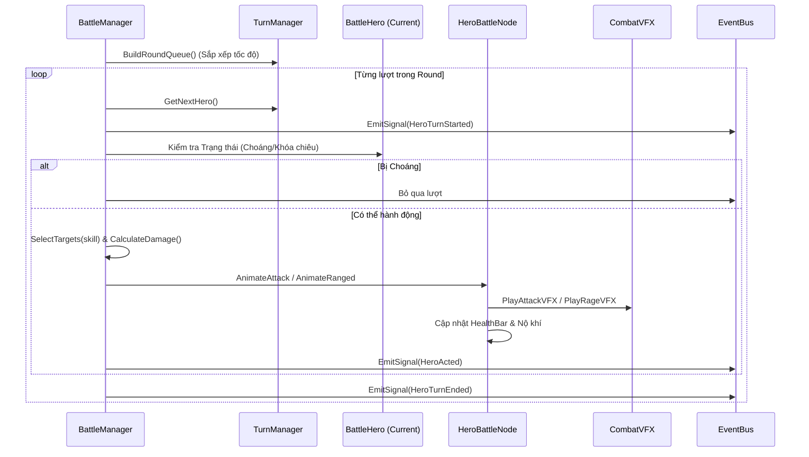

# Hướng Dẫn Kiến Trúc & Cấu Trúc Thư Mục (AI & Developer Guide)

> **Dành cho AI Agents và Lập trình viên:** Tài liệu này mô tả toàn bộ kiến trúc hệ thống, quy ước thiết kế, trách nhiệm của từng thư mục/file, và các nguyên tắc cần tuân thủ tuyệt đối khi phát triển dự án **Tam Quốc 3D (Project Pixel Tactics)**.

---

## 1. Tổng Quan Kỹ Thuật (Tech Stack & Core Rules)

- **Engine:** Godot Engine 4.3 Mono (C#)
- **Runtime:** .NET 8.0 (C# 12)
- **Kiến trúc:** Modular Feature-Based + Data-Driven Custom Resources (`.tres`)
- **Độ phân giải chuẩn:** `1280 x 720` (Canvas Items, Filter Nearest Pixel Art)
- **Lệnh thực thi chuẩn:**
  - Build code: `dotnet build`
  - Chạy Godot Mono Editor: `godot -e` (hoặc `/home/annhan/.local/bin/godot -e`)
  - Chạy game trực tiếp: `godot`

### ⚠️ Nguyên tắc cốt lõi cho AI:
1. **100% C# (.NET 8)**: Không tạo file `.gd` (GDScript). Mọi script gắn vào Node hoặc Resource đều viết bằng C#.
2. **Godot C# Conventions**:
   - Tất cả các class kế thừa `GodotObject`, `Node`, `Resource` đều **phải có từ khóa `partial`** và attribute `[GlobalClass]`.
   - Đặt đúng namespace theo thư mục: `TamQuoc3D.Core.*`, `TamQuoc3D.Data.*`, `TamQuoc3D.Features.*`.
3. **Decoupled Architecture**: Giao tiếp giữa các module thông qua `EventBus` signals hoặc Interfaces, hạn chế phụ thuộc trực tiếp.
4. **Data-Driven**: Mọi cấu hình (Tướng, Kỹ năng, Bản đồ) đều được lưu dưới dạng file `.tres` trong `res://data/database/`.

---

## 2. Cây Thư Mục Chi Tiết & Chức Năng

```text
res://
├── core/                         # Nhân hệ thống dùng chung (Core Engine Layer)
│   ├── autoload/                 # Các singleton autoload toàn cục
│   │   ├── EventBus.cs           # Decoupled Signal Bus cho toàn game
│   │   └── GameManager.cs        # Quản lý game state, tài nguyên (Gold/KNB), chuyển scene
│   ├── interfaces/               # Hợp đồng giao tiếp (Interfaces)
│   │   ├── IEntity.cs            # Interface chung cho thực thể chiến trường
│   │   ├── ISkill.cs             # Interface thông tin kỹ năng
│   │   ├── IEffect.cs            # Interface hiệu ứng buff / debuff
│   │   └── ITurnReceiver.cs      # Interface nhận lượt đánh theo tốc độ
│   ├── constants/                # Hằng số toàn cục
│   │   ├── GameConstants.cs      # Grid 3x3, tốc độ trận, kích thước thanh máu (4px / 90px)
│   │   └── LayerConstants.cs     # Thứ tự hiển thị Z-Index từ nền (0) đến Cut-in (100)
│   └── audio/
│       └── SoundManager.cs       # Bộ tổng hợp âm thanh 8-bit procedural (sfx, hit, rage, heal)
│
├── data/                         # Tầng dữ liệu thuần (Data-Driven Layer)
│   ├── resources/                # Định nghĩa Custom Resources (Class C#)
│   │   ├── HeroData.cs           # Định nghĩa cấu hình tướng (Element, Position, Rarity, Skills)
│   │   ├── HeroStats.cs          # Định nghĩa bộ chỉ số chiến đấu (HP, ATK, DEF, Morale, Crit...)
│   │   ├── SkillData.cs          # Định nghĩa kỹ năng (Type, MoraleCost, DamageMultiplier, Effects)
│   │   └── MapConfig.cs          # Định nghĩa cấu hình sàn đấu / map 3x3 (Background, BGM, Grid)
│   └── database/                 # Cơ sở dữ liệu và các file cấu hình .tres cụ thể
│       ├── HeroDatabase.cs       # Autoload quản lý, nạp và truy vấn tướng từ .tres
│       ├── heroes/               # 15 file .tres: trieu_van.tres, bang_thong.tres, lu_bo.tres,...
│       ├── skills/               # File .tres kỹ năng: hoa_sat.tres, lien_kich.tres,...
│       └── maps/                 # File .tres bản đồ: map_01.tres, map_boss.tres,...
│
├── features/                     # Tầng tính năng độc lập (Modular Feature Layer)
│   ├── battle/                   # Module trận đánh theo lượt (Turn-Based Combat)
│   │   ├── controllers/          # Bộ điều khiển logic trận đấu
│   │   │   ├── BattleManager.cs  # Điều phối vòng lặp round/turn, chọn mục tiêu, lifecycle an toàn
│   │   │   ├── TurnManager.cs    # Tính toán lượt đánh theo tốc độ, team priority, round queue
│   │   │   ├── CombatFormulas.cs # Công thức sát thương, khắc chế nguyên tố, bạo kích, né tránh
│   │   │   └── BattleScene.cs    # Scene controller: HUD, timeline thứ tự lượt, nút bấm, camera shake
│   │   ├── grid/                 # Quản lý trận địa 3x3
│   │   │   ├── Grid3x3.cs        # Tính toán tọa độ đối xứng hoàn hảo giữa Team 0 và Team 1
│   │   │   ├── PedestalSlot.cs   # Lưu trạng thái ô bệ đứng (row, col, hero, isOccupied)
│   │   │   └── CellNode.cs       # Node hiển thị bệ đứng 2.5D trên màn hình
│   │   └── entities/             # Các Node hiển thị thực thể và hiệu ứng
│   │       ├── BattleHero.cs     # Model logic chiến đấu (implements IEntity, ITurnReceiver)
│   │       ├── HeroBattleNode.cs # Entity HD-2D: bệ đứng, aura nộ, sprite 4-frame, tween combat
│   │       ├── HealthBar.cs      # Thanh máu 4px, dài 90px, thanh ghost giảm dần, icon thuộc tính
│   │       ├── CombatVFX.cs      # 30 hiệu ứng kỹ năng & đòn đánh đặc trưng theo từng tướng
│   │       ├── FloatingText.cs   # Số nhảy sát thương, hồi máu, bạo kích, né đòn
│   │       └── SkillCutIn.cs     # Banner kỹ năng cinematic ngắn gọn, không che khuất màn hình
│   ├── deck_builder/             # Module sắp xếp đội hình 3x3
│   │   └── DeckBuilderController.cs # Kéo thả và gán tướng vào 9 ô cờ
│   └── campaign/                 # Module chiến dịch / chọn ải
│       └── CampaignController.cs # Quản lý ải, chương và điều kiện vượt ải
│
├── assets/                       # Tài nguyên hình ảnh, âm thanh chuẩn hóa (Asset Packaging)
│   ├── common/                   # Dùng chung toàn game (icons hệ/buff, audio, fonts, shaders)
│   ├── heroes/                   # Đóng gói theo từng thư mục tướng riêng biệt
│   │   ├── trieu_van/            # spritesheet.png, portrait.png, icon.png, vfx/, audio/
│   │   ├── bang_thong/           # assets riêng của Bàng Thống
│   │   └── ...                   # Tương tự cho 15 tướng
│   ├── environments/             # Bối cảnh & sàn đấu
│   │   ├── _shared/              # Sàn đấu, bóng chân, nền đất
│   │   └── battlefields/         # xich_bich/, quan_do/
│   ├── ui/                       # Giao diện người dùng
│   │   └── shared/               # pedestal_player.png, pedestal_enemy.png, pedestal_active.png,...
│   └── vfx/                      # Hiệu ứng kỹ năng dùng chung (fire/, water/, lightning/, hits/)
│
├── scenes/                       # Các scene .tscn của Godot
│   └── battle/
│       └── BattleScene.tscn      # Main scene trận đấu chính
│
└── docs/                         # Tài liệu Game Design & Kỹ thuật
    ├── 01 Cơ chế Chiến đấu & Đội hình.md
    ├── 02 Thuộc tính & Phát triển Nhân vật.md
    ├── 03 Chế độ Chơi & Hệ thống Online.md
    ├── 04 Kinh tế Trong Game & Monetization.md
    ├── 05 Kiến trúc Kỹ thuật & Hạ tầng.md
    ├── 06 Lộ trình Triển khai & Cột mốc.md
    ├── ARCHITECTURE_AND_DIRECTORIES.md   # Tài liệu này
    └── Game Design Document (GDD) - 2D Pixel Turn-Based S.md
```

---

## 3. Chi Tiết Các Tầng & Luồng Dữ Liệu (Data Flow)

### 3.1. Luồng Khởi Chạy (Boot Flow)
1. Godot khởi động và nạp các **Autoload** được định cấu hình trong `project.godot`:
   - `EventBus`: Khởi tạo hệ thống bus sự kiện tập trung.
   - `GameManager`: Nạp cấu hình game, khởi tạo tiền tệ, danh sách tướng sở hữu.
   - `HeroDatabase`: Quét và nạp toàn bộ file `.tres` trong `res://data/database/heroes/`.
2. Godot nạp scene mặc định: `res://scenes/battle/BattleScene.tscn`.
3. `BattleScene.cs`:
   - Gọi `Grid3x3` để tính toán vị trí hai phe.
   - Lấy dữ liệu tướng từ `HeroDatabase`.
   - Sinh ra các `HeroBattleNode` và gắn `HealthBar`.
   - Chuyển quyền điều khiển cho `BattleManager.StartBattle()`.

### 3.2. Vòng Lặp Trận Đấu (Turn Loop Flow)
Mermaid diagram minh họa luồng vòng lặp trận đánh:



---

## 4. Hướng Dẫn Mở Rộng Tính Năng Dành Cho AI

### Thêm Tướng Mới:
1. Tạo thư mục asset: `res://assets/heroes/<hero_id>/` gồm:
   - `spritesheet.png` (dải hoạt họa 4 frame)
   - `portrait.png` (chân dung)
   - `icon.png` (icon tròn timeline)
   - Thư mục con `vfx/` chứa texture chiêu thức riêng.
2. Tạo file cấu hình: `res://data/database/heroes/<hero_id>.tres` kế thừa `HeroData` với các thuộc tính:
   - `HeroId`, `HeroName`, `Title`, `Element`, `Position`, `Rarity`
   - Chỉ số cơ bản trong `BaseStats` (`HeroStats`)
   - Chiêu đánh thường và Tuyệt kỹ nộ trong `Skills` (`SkillData`)
3. `HeroDatabase` sẽ tự động phát hiện và nạp tướng vào trận.

### Thêm Bản Đồ Mới:
1. Thêm ảnh background vào: `res://assets/environments/battlefields/<map_id>/battlefield.png`.
2. Tạo resource: `res://data/database/maps/<map_id>.tres` kế thừa `MapConfig`.
3. Gán `BackgroundPath` và `BgmPath`.

### Sửa Chỉ Số / Cân Bằng Chiến Đấu:
- Chỉnh sửa công thức tại: [CombatFormulas.cs](file:///home/annhan/Documents/src/tamquoc3d/features/battle/controllers/CombatFormulas.cs).
- Hằng số trận đấu tại: [GameConstants.cs](file:///home/annhan/Documents/src/tamquoc3d/core/constants/GameConstants.cs).
- Không sửa code tùy tiện mà không chạy `dotnet build` và test với `godot --quit-after 20`.
