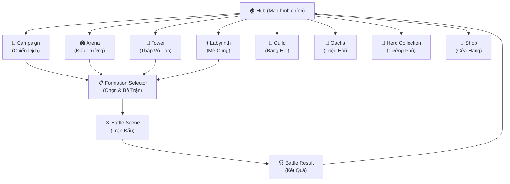
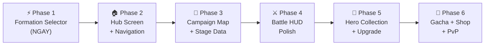

# Kế Hoạch Tổng Quan: Giao Diện Game & Lộ Trình Triển Khai

> **Ngày tạo:** 2026-10-17 | **Trạng thái:** 🔵 Đang lập kế hoạch

---

## 🎯 Mục Tiêu Tổng Thể

Xây dựng đầy đủ giao diện và tính năng game **Project Pixel Tactics — Tam Quốc** theo phong cách MMO chiến thuật (tham chiếu: Long Tướng SV chính TQ):

- Màn hình chính (Hub) với TopBar, Icon Shortcuts, BottomNav, QuestPanel
- Màn hình bố trận (Formation Selector) trước mỗi trận
- Giao diện trận đấu đầy đủ HUD (Timeline, SkillBar, BattleLog)
- Chiến dịch PvE, Tướng Phủ, Gacha, Shop, PvP Arena

---

## 🗺️ Bản Đồ Màn Hình



---

## 📊 Trạng Thái Hiện Tại

| Module | Trạng thái | File chính |
|---|---|---|
| Combat Engine 3x3 Turn-Based | ✅ Hoàn thành | `BattleManager.cs`, `TurnManager.cs`, `CombatFormulas.cs` |
| Pixel Sprite 15 tướng (24 frames) | ✅ Hoàn thành | `AnimatedSprite2D` + `.tres` |
| VFX 15 chiêu nộ | ✅ Hoàn thành | `CombatVFX.cs`, `SkillCutIn.cs` |
| Camera Juice & Hit-stop | ✅ Hoàn thành | `HeroCutInCinematic.cs` |
| Sound Chiptune Elemental | ✅ Hoàn thành | `SoundManager.cs` |
| **Formation Selector UI** | 🚀 Next Step | `DeckBuilderController.cs` (stub) |
| Main Hub UI | ❌ Chưa có | — |
| Campaign Map | ❌ Chưa có | `CampaignController.cs` (stub) |
| Battle HUD (Timeline, SkillBar) | ❌ Chưa có | — |
| Battle Result Screen | ❌ Chưa có | — |
| Hero Collection UI | ❌ Chưa có | — |
| Gacha System | ❌ Chưa có | — |
| Shop System | ❌ Chưa có | — |
| PvP Arena | ❌ Chưa có | — |
| Tower / Labyrinth | ❌ Chưa có | — |
| Guild System | ❌ Chưa có | — |

---

## 📐 Lộ Trình 6 Phase



| Phase | Tên | Ưu tiên | Ước lượng | File kế hoạch |
|---|---|---|---|---|
| 1 | Formation Selector | 🔴 Cao nhất | 3-4 ngày | `phase1_formation_selector.md` |
| 2 | Hub Screen + Navigation | 🔴 Cao | 4-5 ngày | `phase2_hub_screen.md` |
| 3 | Campaign Map + Stage Data | 🟡 Trung | 5-7 ngày | `phase3_campaign_map.md` |
| 4 | Battle HUD Polish | 🟡 Trung | 3-4 ngày | `phase4_battle_hud.md` |
| 5 | Hero Collection + Upgrade | 🟢 Thấp | 4-5 ngày | `phase5_hero_collection.md` |
| 6 | Economy, Gacha, Shop, PvP | 🟢 Thấp | 10-14 ngày | `phase6_economy_systems.md` |

---

## 🔧 Hệ Thống Ngang (Cross-Cutting) — Cần tạo song song

### `core/navigation/SceneNavigator.cs`
Module điều hướng toàn cục — tất cả chuyển scene phải đi qua đây:

```csharp
public static class SceneNavigator {
    public static void GoToHub();
    public static void GoToFormationSelector(string context); // "campaign","arena","tower"
    public static void GoToBattle(FormationData formation, BattleConfig config);
    public static void GoToCampaign();
    public static void GoToHeroCollection();
    public static void GoToShop();
    public static void GoToGacha();
    public static void GoToArena();
    public static void GoToTower();
    public static void GoToLabyrinth();
    public static void GoToGuild();
}
```

### `EventBus.cs` — Signals cần bổ sung toàn bộ

```csharp
// Navigation
[Signal] public delegate void SceneChangeRequestedEventHandler(string scenePath, Godot.Collections.Dictionary data);

// Player & Currency
[Signal] public delegate void ProfileLoadedEventHandler();
[Signal] public delegate void LevelUpEventHandler(int newLevel);
[Signal] public delegate void VipLevelChangedEventHandler(int vipLevel);
[Signal] public delegate void GoldChangedEventHandler(int delta, int total);
[Signal] public delegate void DiamondChangedEventHandler(int delta, int total);
[Signal] public delegate void StaminaChangedEventHandler(int current, int max);

// Hero
[Signal] public delegate void HeroUnlockedEventHandler(string heroId);
[Signal] public delegate void HeroLevelUpEventHandler(string heroId, int level);
[Signal] public delegate void HeroStarUpEventHandler(string heroId, int stars);

// Quest & Daily
[Signal] public delegate void QuestProgressUpdatedEventHandler(string questId, int current, int target);
[Signal] public delegate void QuestCompletedEventHandler(string questId);
[Signal] public delegate void DailyQuestResetEventHandler();

// Battle
[Signal] public delegate void SkillSelectedEventHandler(int skillIndex);
[Signal] public delegate void TargetSelectedEventHandler(string heroId);
[Signal] public delegate void BattleSpeedChangedEventHandler(float speed);
[Signal] public delegate void BattlePausedEventHandler(bool isPaused);
[Signal] public delegate void RageSkillActivatedEventHandler(string heroId);
[Signal] public delegate void BattleLogEntryAddedEventHandler(string message);

// Social
[Signal] public delegate void ChatMessageReceivedEventHandler(string sender, string message, string channel);
[Signal] public delegate void SystemNotificationEventHandler(string title, string body, string type);
```

### `GameManager.cs` — Properties cần bổ sung

```csharp
public PlayerProfile CurrentPlayer { get; private set; }
public List<string> OwnedHeroIds { get; private set; }
public List<FormationPreset> SavedFormations { get; private set; } // tối đa 3
public DailyQuestProgress DailyQuests { get; private set; }
public int TowerMaxFloor { get; private set; }
public int ArenaRank { get; private set; }
```

---

## 🎨 Assets UI — Cấu Trúc Tổng Thể

```
assets/ui/
├── shared/           ← đã có: pedestal_*.png
├── battle/           ← RỖNG — Phase 4
├── formation/        ← RỖNG — Phase 1
├── hero_info/        ← RỖNG — Phase 5
└── hub/              ← CHƯA CÓ — Phase 2
    ├── topbar_bg.png
    ├── bottom_nav_bg.png
    ├── shortcut_icon_frame.png
    └── quest_panel_bg.png
```

---

## ✅ Tiêu Chí Hoàn Thành Tổng Thể

- [ ] Game loop end-to-end hoạt động: Hub → Formation → Battle → Result → Hub
- [ ] 15 tướng đều có thể chọn & bố trận
- [ ] Campaign Chapter 1 (5 ải) chơi được hoàn chỉnh
- [ ] Battle HUD hiển thị đầy đủ: HP, Nộ, Timeline, SkillBar, BattleLog
- [ ] Hero Collection xem được stats & kỹ năng
- [ ] Không crash khi chuyển scene
