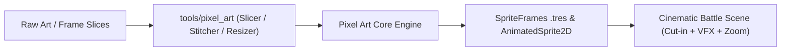

# Kế Hoạch Nâng Cấp Sprite Pixel Art, Animation & Hiệu Ứng Chiêu Thức Mượt Đẹp

> [!IMPORTANT]
> **Mục tiêu cốt lõi**: Nâng tầm đồ họa trận chiến từ phong cách prototype 4-frame thô ráp lên chuẩn **HD-2D Retro Arcade (phong cách Tam Quốc Chí Capcom / Neo-Geo / Octopath Traveler)**:
> 1. Nhân vật có chiều sâu, trang phục giáp trụ sắc sảo, dải màu phong phú (24 frames/tướng).
> 2. Hoạt ảnh nhịp nhàng, mượt mà (6 frame Idle thở/bay tà áo, 6 frame combo tấn công chém vung, 6 frame xuất tuyệt kỹ nộ hoành tráng, 3 frame hurt, 3 frame death).
> 3. Hiệu ứng chiêu thức (VFX) đa tầng nhiều frame (frame-by-frame) sống động thay vì hình tĩnh biến đổi scale.
> 4. Điện ảnh hóa trận đấu với Super Move Cut-in Portrait, Camera Hit-Stop Zoom, và âm thanh đa âm sắc.
> 5. Màn hình chọn đội hình tự do 5/15 tướng trực quan trước trận đấu.

---

## 1. Hiện Trạng & Tiến Độ Triển Khai

| Yếu tố | Trước nâng cấp | Sau nâng cấp | Trạng thái |
| :--- | :--- | :--- | :--- |
| **Spritesheet** | 4 frame (256x64 px), 64x64 mỗi frame | 24 frame (384x256 px) chia 4 hàng: Idle 6f, Attack 6f, Skill 6f, Hurt/Death 6f | ✅ **Hoàn thành 15/15 tướng** |
| **Bảng màu (Palette)** | 14 - 20 màu cơ bản / sprite | Chuẩn màu 32-64 màu phong cách Neo-Geo/Arcade, đổ bóng dither | ✅ **Hoàn thành 15/15 tướng** |
| **Cơ chế Animation** | Tween đổi `Sprite.Frame = 0..3` thủ công trong C# | Tích hợp Godot 4.3 `AnimatedSprite2D` tải trực tiếp `sprite_frames.tres` | ✅ **Hoàn thành** |
| **Juice & Game Feel** | Lướt tượng phẳng đơ | Squash & Stretch, vệt chém smear arc, FootShadow ellipse co dãn | ✅ **Hoàn thành** |
| **Hiệu ứng VFX** | Sprite tĩnh scale/fade | Sprite strip VFX đa frame 96x96 (15/15 chiêu thức nộ AnimatedSprite2D) | ✅ **Hoàn thành 15/15 chiêu** |
| **Camera & Hit-stop** | Camera tĩnh, không rung phóng | Zoom cận cảnh 1.08x và slow-motion 0.1s khi Bạo Kích hoặc Kết Liễu | ✅ **Hoàn thành** |
| **Cut-In Siêu Kỹ Năng** | Chỉ có banner chữ phẳng | Portrait cận cảnh trượt chéo + dải viền hào quang nguyên tố & song đấu | ✅ **Hoàn thành** |
| **Âm thanh Đa Âm Sắc** | 1 tiếng chém chung chung | Âm sắc Chiptune riêng cho từng hệ: Sấm, Lửa nổ, Gió lốc, Nước cuộn, Đàn tranh | ✅ **Hoàn thành** |
| **Chọn Đội Hình 3x3** | Mặc định cứng trong code | Màn hình chọn 5/15 tướng & sắp xếp Tiền/Trung/Hậu quân trực quan | 🚀 **Đang thực hiện (Next Step)** |

---

## 2. Kiến Trúc Pipeline Công Cụ Pixel Art (`tools/pixel_art/`)

Đã đóng gói thành công bộ công cụ chuẩn hóa:
- [`tools/pixel_art/slicer.py`](file:///home/annhan/Documents/src/tamquoc3d/tools/pixel_art/slicer.py): Tách spritesheet thành các frame rời rạc.
- [`tools/pixel_art/stitcher.py`](file:///home/annhan/Documents/src/tamquoc3d/tools/pixel_art/stitcher.py): Ghép các frame thành dải strip hoặc grid.
- [`tools/pixel_art/resizer.py`](file:///home/annhan/Documents/src/tamquoc3d/tools/pixel_art/resizer.py): Chuẩn hóa kích thước khung hình (64, 96, 128) không vỡ nét (Nearest-Neighbor).
- [`tools/pixel_art/tres_generator.py`](file:///home/annhan/Documents/src/tamquoc3d/tools/pixel_art/tres_generator.py): Tự động xuất `.tres` `SpriteFrames` cho Godot.
- [`tools/pixel_art_mcp/server.js`](file:///home/annhan/Documents/src/tamquoc3d/tools/pixel_art_mcp/server.js): Cung cấp 7 công cụ JSON-RPC stdio qua MCP.

---

## 3. Lộ Trình Triển Khai Chi Tiết

### Giai đoạn 1: Cấu hình MCP Server & Pipeline Công Cụ
- [x] Thêm cấu hình MCP Pixel Art vào `~/.gemini/config/mcp_config.json`.
- [x] Xây dựng bộ script Python tiện ích trong `tools/pixel_art/`:
  - Cắt ghép spritesheet (Slicer & Stitcher).
  - Chuẩn hóa kích thước khung hình (64x64, 96x96, 128x128).
  - Xuất file `.tres` (`SpriteFrames`) tự động nạp thẳng vào Godot.
- [x] Đăng ký 7 MCP tools trong `server.js` v1.1.0 và đồng bộ schemas.

### Giai đoạn 2: Nâng Cấp Hệ Thống Hoạt Ảnh Trong Godot (`HeroBattleNode`)
- [x] Thay thế logic gán `Frame = 0..3` thủ công bằng hệ thống `AnimatedSprite2D`:
  - `play("idle")`: 6 frame, tốc độ 8 FPS lặp vô tận (nhịp thở, tà áo, đuôi tóc lay động).
  - `play("attack")`: 6 frame (Chuẩn bị vung đòn -> Vung hết biên độ -> Thu thế).
  - `play("skill")`: 6 frame kết hợp hiệu ứng hào quang phát sáng.
  - `play("hurt")`: 3 frame giật lùi, chớp trắng.
  - `play("death")`: 3 frame gục ngã xuống đất rồi mờ dần.
- [x] Bổ sung hiệu ứng cơ học tự nhiên: **Squash & Stretch** nhẹ (nén xuống khi lấy đà, giãn ra khi phóng tới), **Bóng đổ FootShadow ellipse** co giãn theo độ cao chân và chuyển động.

### Giai đoạn 3: Tái Thiết Kế Bộ Sprite & VFX Mẫu Cho Cặp Tướng Chủ Lực
- [x] Triển khai bản mẫu đỉnh cao cho 2 đại tướng đại diện:
  - **Triệu Tử Long (Phe Ta)**: Giáp bạc viền lam, thương Bạch Long quét vệt sáng vòng cung mượt mà, tuyệt kỹ nộ triệu hồi thanh long uốn lượn đa frame.
  - **Chiến Thần Lữ Bố (Phe Địch)**: Giáp đen hắc kim, mũ lông trĩ phất phơ, Phương Thiên Họa Kích chém chém bổ dọc nứt đất, tuyệt kỹ Ma Thần giáng thế rực lửa đỏ thẫm.
- [x] Chạy kiểm thử so sánh độ mượt (FPS, cảm giác lực đánh, độ đã mắt) trên sàn đấu.

### Giai đoạn 4: Mở Rộng Đồng Bộ 15 Tướng & Đóng Gói
- [x] Nâng cấp trọn bộ 15 danh tướng lên chuẩn HD-2D `AnimatedSprite2D` & `.tres`.
- [x] Hoàn thiện thư viện hiệu ứng chiêu thức (VFX Strips 96x96 @ 16 FPS đa frame cho toàn bộ 15 tuyệt kỹ nộ).
- [x] Tích hợp camera zoom cận cảnh 1.08x và slow-motion nhẹ 0.1s khi đòn kết liễu hoặc Bạo Kích diễn ra (Arcade hit-stop).

### Giai đoạn 5: Trải Nghiệm Điện Ảnh Hóa Chiến Đấu (Cinematic Juice & Audio)
- [x] **Super Move Cut-In Portrait**: Khi tướng đầy nộ thi triển chiêu thức, chân dung tướng (Portrait) trượt chéo qua màn hình với vệt sáng ánh kim, tên danh tướng và tuyệt chiêu phong cách game đối kháng arcade (`HeroCutInCinematic.cs`).
- [x] **Âm thanh Chiptune Đa Âm Sắc (Elemental Chiptune SFX)**: Bổ sung âm sắc riêng cho từng nguyên tố (Sấm sét, Gió lốc, Đạn lửa, Nước cuộn, Tiếng đàn tranh) trong `SoundManager.cs` kết nối trực tiếp vào `PlayElementSfx`.

### Giai đoạn 6 (Next Step): Màn Hình Chọn Đội Hình & Sắp Xếp Trận Đồ (Pre-Battle Formation Selector)
- [ ] **Giao diện Roster Danh Tướng (15 Tướng)**:
  - Hiển thị danh sách card tướng với Avatar, Tên, Hệ nguyên tố (Thủy/Hỏa/Phong/Quang/Ám) và Vai trò (Tiền phong, Hộ vệ, Cung thủ, Quân sư, Hỗ trợ).
- [ ] **Bàn cờ Bố Trận 3x3 Trực Quan**:
  - Tiền quân: 1 ô chính giữa (tuân thủ nghiêm ngặt luật chỉ 1 Tiền quân).
  - Trung quân: 2 ô trên và dưới.
  - Hậu quân: 2 ô trên và dưới.
- [ ] **Tương tác Kéo Thả / Click-to-Assign**:
  - Nhấp vào thẻ tướng rồi nhấp vào ô trống trên bàn cờ để đặt tướng vào vị trí.
  - Nút "Tự Động Bố Trận" (Auto-Deploy) đề xuất đội hình chuẩn cân bằng.
- [ ] **Nút "XUẤT TRẬN"**:
  - Truyền danh sách 5 tướng đã xếp sang `BattleScene` để khởi động trận chiến ngay lập tức.
