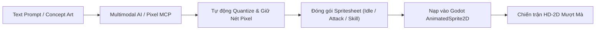

# Kế Hoạch Nâng Cấp Sprite Pixel Art, Animation & Hiệu Ứng Chiêu Thức Mượt Đẹp

> [!IMPORTANT]
> **Mục tiêu cốt lõi**: Nâng tầm đồ họa trận chiến từ phong cách prototype 4-frame thô ráp lên chuẩn **HD-2D Retro Arcade (phong cách Tam Quốc Chí Capcom / Neo-Geo / Octopath Traveler)**:
> 1. Nhân vật có chiều sâu, trang phục giáp trụ sắc sảo, dải màu phong phú.
> 2. Hoạt ảnh nhịp nhàng, mượt mà (6-8 frame Idle thở/bay tà áo, 4-6 frame combo tấn công chém vung, 6-8 frame xuất tuyệt kỹ nộ hoành tráng).
> 3. Hiệu ứng chiêu thức (VFX) đa tầng nhiều frame (frame-by-frame) sống động thay vì hình tĩnh biến đổi scale.

---

## 1. Hiện Trạng & Vấn Đề Cần Khắc Phục

| Yếu tố | Hiện trạng | Vấn đề | Mục tiêu nâng cấp |
| :--- | :--- | :--- | :--- |
| **Spritesheet** | 4 frame (256x64 px), 64x64 mỗi frame | Quá ít frame: Idle chỉ 2 frame giật cục, Attack chỉ 1 hình tĩnh trượt tới, Hurt 1 hình | Tăng lên 6-8 frame Idle, 4-6 frame Attack, 6-8 frame Skill, 3 frame Hurt |
| **Bảng màu (Palette)** | 14 - 20 màu cơ bản / sprite | Thiếu bóng mờ (shadow ramps), thiếu highlight kim loại của giáp trụ, màu bẹt | Chuẩn bảng màu 32-64 màu phong cách Neo-Geo/Arcade, đổ bóng dither tinh tế |
| **Cơ chế Animation** | Tween đổi `Sprite.Frame = 0/1/2/3` thủ công trong C# | Khó kiểm soát timing từng frame, không hỗ trợ transition mượt mà | Chuyển sang `AnimatedSprite2D` với `SpriteFrames` hoặc `AnimationPlayer` chuyên nghiệp |
| **Hiệu ứng VFX** | Sprite tĩnh scale/fade (ví dụ `vfx_spear_blue.png`) | Thiếu chuyển động liên hoàn, không có cảm giác va chạm nảy lửa | Sprite strip VFX đa frame (Vệt chém xoay tròn, rồng lượn, sóng âm, nổ lửa bốc khói) |

---

## 2. Giải Pháp Tích Hợp MCP Server Cho Pixel Art

Để hỗ trợ AI và pipeline tự động tạo, tối ưu và xử lý Pixel Art trực tiếp trong project, chúng ta có 3 lựa chọn MCP:

### Lựa chọn A (Đề xuất): `pixelart-mcp` (Python/Pillow Local Tool)
- **Đặc điểm**: Chạy cục bộ không phụ thuộc bản quyền ngoài, sử dụng Python & Pillow.
- **Tính năng**:
  - Tự động lượng tử hóa màu (Color Quantization) theo bảng màu Retro Tam Quốc.
  - Tự động downscale Nearest-Neighbor giữ pixel sắc nét 100%, không bị mờ nhòe (bilinear blur).
  - Tự động ghép nối các frame đơn lẻ thành Horizontal Spritesheet chuẩn cho Godot.
  - Sinh chuỗi animation nhịp thở (breathing cycle), chớp mắt, vung đao từ ảnh base.

### Lựa chọn B: `willibrandon/pixel-mcp` (Aseprite Headless/Bridge)
- **Đặc điểm**: Kết nối trực tiếp với Aseprite qua CLI / Lua Script.
- **Tính năng**: Quản lý cels, tags (`idle`, `attack`, `skill`, `hurt`), export trực tiếp file `.aseprite` và `.png` kèm metadata JSON.
- **Yêu cầu**: Cần cài đặt sẵn Aseprite trên máy Linux.

### Lựa chọn C: `freema/pixelforge-mcp` (Multimodal AI Pixel Forge)
- **Đặc điểm**: Tạo sprite concept từ prompt mô tả (ví dụ: *"Triệu Vân múa thương tạo rồng xanh pixel 64x64"*), tự động cắt frame strip và đóng gói spritesheet.

---

## 3. Lộ Trình Triển Khai (4 Giai Đoạn)

### Giai đoạn 1: Cấu hình MCP Server & Pipeline Công Cụ
- [x] Thêm cấu hình MCP Pixel Art vào `~/.gemini/config/mcp_config.json`.
- [x] Xây dựng bộ script Python tiện ích trong `tools/pixel_art_mcp/` để tự động hóa:
  - Cắt ghép spritesheet (Slicer & Stitcher).
  - Chuẩn hóa kích thước khung hình (64x64 và 128x128 cho các đòn đại chiêu).
  - Xuất file `.tres` (`SpriteFrames`) tự động nạp thẳng vào Godot.

### Giai đoạn 2: Nâng Cấp Hệ Thống Hoạt Ảnh Trong Godot (`HeroBattleNode`)
- [x] Thay thế logic gán `Frame = 0..3` thủ công bằng hệ thống `AnimatedSprite2D`:
  - `play("idle")`: 6 frame, tốc độ 8-10 FPS lặp vô tận (nhịp thở, tà áo, đuôi tóc lay động).
  - `play("attack")`: 4-6 frame (Chuẩn bị vung đòn -> Vung hết biên độ -> Thu thế).
  - `play("skill")`: 6-8 frame kết hợp hiệu ứng hào quang phát sáng.
  - `play("hurt")`: 2-3 frame giật lùi, chớp trắng.
  - `play("death")`: 4-5 frame gục ngã xuống đất rồi mờ dần.
- [x] Bổ sung hiệu ứng cơ học tự nhiên: **Squash & Stretch** nhẹ (nén xuống khi lấy đà, giãn ra khi phóng tới), **Bóng đổ ellipse** co giãn theo độ cao chân.

### Giai đoạn 3: Tái Thiết Kế Bộ Sprite & VFX Mẫu Cho Cặp Tướng Chủ Lực
- [x] Triển khai bản mẫu đỉnh cao cho 2 đại tướng đại diện:
  - **Triệu Tử Long (Phe Ta)**: Giáp bạc viền lam, thương Bạch Long quét vệt sáng vòng cung mượt mà, tuyệt kỹ nộ triệu hồi thanh long uốn lượn đa frame.
  - **Chiến Thần Lữ Bố (Phe Địch)**: Giáp đen hắc kim, mũ lông trĩ phất phơ, Phương Thiên Họa Kích chém chém bổ dọc nứt đất, tuyệt kỹ Ma Thần giáng thế rực lửa đỏ thẫm.
- [x] Chạy kiểm thử so sánh độ mượt (FPS, cảm giác lực đánh, độ đã mắt) trên sàn đấu.

### Giai đoạn 4: Mở Rộng Đồng Bộ 15 Tướng & Đóng Gói
- [x] Nâng cấp trọn bộ 15 danh tướng:
  - *Quan Vũ, Trương Phi, Mã Siêu, Hoàng Trung, Gia Cát Lượng, Điển Vi, Chu Du, v.v.*
- [x] Hoàn thiện thư viện hiệu ứng chiêu thức (VFX Strips):
  - Lốc gió Bát Trận Đồ, Lửa Xích Bích thiêu đốt, Nước đàn Trị liệu Sen hồng của Tiểu Kiều (15/15 chiêu thức nộ đa frame).
- [x] Tích hợp camera zoom cận cảnh / slow-motion nhẹ 0.1s khi đòn kết liễu hoặc Bạo Kích diễn ra (Arcade hit-stop).

---

## 4. Bảng So Sánh Trước & Sau Khi Nâng Cấp

| Đặc điểm | Trước (Hiện tại) | Sau (Khi hoàn thiện) |
| :--- | :--- | :--- |
| **Số frame / tướng** | 4 frame duy nhất | 20 - 24 frame chia theo từng động tác |
| **Tốc độ mắt nhìn (Framerate)** | 2.5 FPS (nhấp nháy) | 10 - 12 FPS (mượt như game thùng arcade) |
| **Độ chân thực lực đánh** | Tướng lướt đơ như tượng cờ | Có đà vung đao, quán tính nảy người, vệt chém theo góc |
| **Hiệu ứng chiêu thức** | 1 ảnh png phóng to/thu nhỏ | Chuỗi animation biến hóa (nở rộ, nổ bung, xoáy lốc) |
| **Độ khớp chiến trường** | Dễ bị lệch nhịp hiển thị | Khớp 100% từng mili-giây va chạm |
