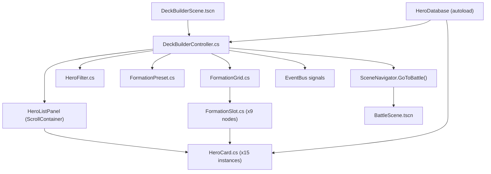

# Phase 1 — Formation Selector (Chọn & Bố Trận)

> **Ngày tạo:** 2026-10-17 | **Ưu tiên:** 🔴 Cao nhất | **Ước lượng:** 3-4 ngày | **Trạng thái:** ✅ Hoàn thành 100%

---

## 🎯 Mục Tiêu

- Hoàn thiện màn hình chọn 5/15 tướng và bố trận trước mỗi trận đấu
- Kết nối trực tiếp với `BattleScene` khi nhấn **XUẤT TRẬN**
- Đây là **mắt xích quan trọng nhất** để game loop cơ bản hoạt động end-to-end

---

## 📋 Bảng Tổng Quan Công Việc

| # | Task | File | Ưu tiên | Ước lượng | Trạng thái |
|---|---|---|---|---|---|
| 1.1 | Scene chính DeckBuilder | `DeckBuilderScene.tscn` | 🔴 | 1h | ✅ Hoàn thành |
| 1.2 | Controller chính | `DeckBuilderController.cs` | 🔴 | 3h | ✅ Hoàn thành |
| 1.3 | Widget card tướng | `HeroCard.cs` | 🔴 | 2h | ✅ Hoàn thành |
| 1.4 | Lưới bố trận 3x3 | `FormationGrid.cs` | 🔴 | 2h | ✅ Hoàn thành |
| 1.5 | Ô đặt tướng | `FormationSlot.cs` | 🔴 | 1h | ✅ Hoàn thành |
| 1.6 | Bộ lọc tướng | `HeroFilter.cs` | 🟡 | 1.5h | ✅ Hoàn thành |
| 1.7 | Preset đội hình | `FormationPreset.cs` | 🟡 | 1.5h | ✅ Hoàn thành |
| 1.8 | Auto-deploy AI | trong `DeckBuilderController` | 🟡 | 2h | ✅ Hoàn thành |
| 1.9 | Assets UI formation | `assets/ui/formation/` | 🔴 | 2h | ✅ Hoàn thành |
| 1.10 | Kết nối → BattleScene | `SceneNavigator.cs` | 🔴 | 1h | ✅ Hoàn thành |
| 1.11 | EventBus signals | `EventBus.cs` | 🔴 | 0.5h | ✅ Hoàn thành |

---

## 📁 Sơ Đồ Quan Hệ File



---

## ✅ Chi Tiết Từng Task

### Task 1.1 — Tạo `DeckBuilderScene.tscn`

- [x] Tạo file scene: `features/deck_builder/scenes/DeckBuilderScene.tscn`
- [x] Thêm root node `Control` (CanvasLayer)
- [x] Layout 2 cột: trái = `HeroListPanel`, phải = `FormationPanel`
- [x] Thêm node `HBoxContainer` chia đôi màn hình (tỉ lệ 40%/60%)
- [x] Thêm nút **XUẤT TRẬN** (`Button`, bottom-right, disabled khi chưa đủ tướng)
- [x] Thêm nút **⬅ Quay Lại** (`Button`, bottom-left)
- [x] Thêm label **Tổng Lực Chiến** (`Label`, bottom-center)
- [x] Attach script `DeckBuilderController.cs`

---

### Task 1.2 — Hoàn thiện `DeckBuilderController.cs`

**1.2.1 — Khởi tạo & Load dữ liệu**
- [x] `_Ready()`: Load 15 tướng từ `HeroDatabase`, spawn `HeroCard` cho mỗi tướng
- [x] `_Ready()`: Khởi tạo `FormationGrid` với 9 ô (chỉ 5 ô active: row 0 col 1, row 1 col 0/2, row 2 col 0/2)
- [x] `LoadSavedFormation()`: Đọc preset đã lưu từ `GameManager.SavedPresets` hoặc auto-deploy khởi đầu

**1.2.2 — Logic Click-to-Assign**
- [x] `OnHeroCardClicked(string heroId)`: Đánh dấu card đang được chọn (highlight viền vàng)
- [x] `OnSlotClicked(int row, int col)`: Nếu có card đang chọn → gán vào ô
- [x] Kiểm tra: mỗi tướng chỉ xuất hiện 1 lần trong đội hình
- [x] Kiểm tra: ô `row=0, col=1` (Tiền quân) nhận tướng vai trò Tiền phong hoặc bất kỳ

**1.2.3 — Logic Swap & Remove**
- [x] `OnSlotClicked()` khi ô đã có tướng + không có card đang chọn → bật highlight "đang chọn ô"
- [x] Click ô thứ 2 → hoán đổi tướng giữa 2 ô
- [x] Click lại chính ô đó → bỏ chọn
- [x] Nút **X** nhỏ góc trên phải mỗi `FormationSlot` → xóa tướng khỏi ô

**1.2.4 — Cập nhật UI sau mỗi thay đổi**
- [x] `UpdateTotalPower()`: Tính tổng lực chiến 5 tướng, hiển thị Label
- [x] `UpdateStartButton()`: Enable nút XUẤT TRẬN khi đủ ≥ 1 tướng (hoặc = 5)
- [x] `UpdateHeroCardAvailability()`: Dim card đã có trong đội hình

**1.2.5 — Nút XUẤT TRẬN**
- [x] `OnStartBattlePressed()`: Thu thập `List<FormationEntry>` từ grid
- [x] Gọi `EmitSignal(SignalName.FormationConfirmed, formation)`
- [x] Gọi `SceneNavigator.GoToBattle(formation)`

**1.2.6 — Nút Quay Lại**
- [x] `OnBackPressed()`: Gọi `SceneNavigator.GoBack()`

---

### Task 1.3 — Tạo `HeroCard.cs`

- [x] Tạo file: `features/deck_builder/ui/HeroCard.cs` (extends `Control`)
- [x] Properties: `string HeroId`, `HeroData Data`, `bool IsSelected`, `bool IsInFormation`
- [x] Sub-nodes:
  - [x] `TextureRect Portrait` — hiện `portrait.png` của tướng
  - [x] `Label NameLabel` — tên tướng (font pixel)
  - [x] `TextureRect ElementIcon` — icon hệ nguyên tố (5 loại)
  - [x] `HBoxContainer StarsContainer` — 1-5 sao (TextureRect icons)
  - [x] `Label PowerLabel` — lực chiến (số, font nhỏ)
  - [x] `Panel SelectionOverlay` — lớp màu vàng khi selected
  - [x] `Panel DimOverlay` — lớp tối khi đã trong đội hình
- [x] `void SetData(HeroData data)`: Gán toàn bộ hiển thị
- [x] `void SetSelected(bool selected)`: Bật/tắt SelectionOverlay
- [x] `void SetInFormation(bool inFormation)`: Bật/tắt DimOverlay
- [x] Signal `Clicked(string heroId)` khi người dùng click card
- [x] Mouse hover: scale nhẹ 1.06x (Tween)

---

### Task 1.4 — Tạo `FormationGrid.cs`

- [x] Tạo file: `features/deck_builder/ui/FormationGrid.cs` (extends `Control`)
- [x] Khởi tạo 9 `FormationSlot` theo layout 3x3:
  ```
  Row 0: [❌ trống] [✅ Tiền quân] [❌ trống]
  Row 1: [✅ Trung quân]           [✅ Trung quân]
  Row 2: [✅ Hậu quân]             [✅ Hậu quân]
  ```
- [x] `Dictionary<(int row, int col), HeroData> Formation` — lưu tướng theo vị trí
- [x] `bool AssignHero(HeroData hero, int row, int col)`: Gán tướng vào ô, trả về success
- [x] `void RemoveHero(int row, int col)`: Xóa tướng khỏi ô
- [x] `void SwapHeroes(int r1, int c1, int r2, int c2)`: Hoán đổi 2 ô
- [x] `List<FormationEntry> GetFormation()`: Trả về danh sách có heroId + vị trí
- [x] `void ClearAll()`: Xóa hết đội hình
- [x] Label nhỏ phía trên mỗi hàng: "⚔️ TIỀN QUÂN" / "🛡️ TRUNG QUÂN" / "🏹 HẬU QUÂN"

---

### Task 1.5 — Tạo `FormationSlot.cs`

- [x] Tạo file: `features/deck_builder/ui/FormationSlot.cs` (extends `Control`)
- [x] Properties: `int Row`, `int Col`, `bool IsActive`, `bool IsOccupied`, `string OccupiedHeroId`
- [x] Sub-nodes:
  - [x] `TextureRect Background` — `slot_empty.png` / `slot_filled.png` / `slot_inactive.png`
  - [x] `TextureRect HeroPortrait` — portrait thu nhỏ của tướng (ẩn khi trống)
  - [x] `Label HeroNameLabel` — tên tướng ngắn (ẩn khi trống)
  - [x] `Button RemoveButton` — nút X góc trên phải (ẩn khi trống)
  - [x] `TextureRect HighlightOverlay` — viền sáng khi đang hover/chọn
- [x] `void SetHero(HeroData hero)`: Hiện portrait + tên, bật RemoveButton
- [x] `void ClearHero()`: Reset về trạng thái trống
- [x] `void SetHighlight(bool on)`: Bật/tắt viền sáng
- [x] Signal `SlotClicked(int row, int col)`
- [x] Signal `RemoveClicked(int row, int col)`

---

### Task 1.6 — Tạo `HeroFilter.cs`

- [x] Tạo file: `features/deck_builder/ui/HeroFilter.cs` (extends `HBoxContainer`)
- [x] Dropdown **Hệ nguyên tố**: Tất cả / Hỏa / Thủy / Phong / Quang / Ám
- [x] Dropdown **Vai trò / Vị trí**: Tất cả / Tiền quân / Trung quân / Hậu quân
- [x] Dropdown **Sắp xếp**: Lực Chiến ↓ / Tên A-Z / Phẩm (UR→R) / Hệ
- [x] `List<HeroData> ApplyFilter(IEnumerable<HeroData> heroes)`: Trả về danh sách đã lọc
- [x] Signal `FilterChanged()` → controller re-render danh sách card

---

### Task 1.7 — Tạo `FormationPreset.cs`

- [x] Tạo file `data/resources/FormationPreset.cs` (extends `Resource`)
- [x] Fields: `string PresetName`, `Array<FormationEntry> Entries`, `long SavedAtUnix`
- [x] `FormationEntry`: `string HeroId`, `int Row`, `int Col`
- [x] Tối đa 3 preset, lưu vào `GameManager.SavedPresets`
- [x] UI: 3 nút slot preset (#1, #2, #3) + nút Lưu phía trên bảng bố trận

---

### Task 1.8 — Auto-Deploy AI

- [x] `AutoDeploy()`: Lấy top tướng theo lực chiến trong danh sách sở hữu
- [x] Ưu tiên: 1 tướng Tiền phong / ATK cao nhất → Tiền quân (row 0, col 1)
- [x] 2 tướng DEF/HP cao → Trung quân (row 1, col 0 & 2)
- [x] 2 tướng còn lại (support/hậu quân) → Hậu quân (row 2, col 0 & 2)
- [x] Nút **[🤖 Tự Động Bố Trận]** gọi `AutoDeploy()`
- [x] Nút **[🗑️ Xóa Tất Cả]** gọi `FormationGrid.ClearAll()`

---

### Task 1.9 — Assets UI `assets/ui/formation/`

- [x] `formation_grid_bg.png` — nền bảng bố trận cổ phong (640x480)
- [x] `slot_empty.png` (96x96) — ô trống: viền vàng mờ, dấu + ở giữa
- [x] `slot_filled.png` (96x96) — ô có tướng: viền vàng sáng
- [x] `slot_inactive.png` (96x96) — ô bị disable (tối, không click được)
- [x] `hero_card_bg_*.png` (x6) — nền card theo hệ (default, fire, water, wind, light, dark)
- [x] `hero_card_frame_*.png` (x2) — viền card trạng thái (selected, in_formation)
- [x] `btn_auto_deploy.png` & `btn_clear_formation.png` — texture nút chức năng
- [x] `icon_star_filled.png` & `icon_star_empty.png` (16x16) — icon sao

---

### Task 1.10 — Tạo `SceneNavigator.cs`

- [x] Tạo file: `core/navigation/SceneNavigator.cs`
- [x] `GoToBattle(IEnumerable<FormationEntry> formation, object config)`:
  - Lưu `formation` vào `GameManager.CurrentFormation`
  - Đặt trạng thái `GameManager.CurrentState = Battle`
  - Chuyển scene sang `res://features/battle/scenes/BattleScene.tscn`
- [x] `GoToFormationSelector(string context)`:
  - Lưu `context` vào `GameManager.BattleContext`
  - Đặt `GameManager.CurrentState = DeckBuilder`
  - Chuyển scene sang `res://features/deck_builder/scenes/DeckBuilderScene.tscn`
- [x] `GoBack()`: Quay lại scene trước đó

---

### Task 1.11 — Bổ sung EventBus Signals

Thêm vào `core/autoload/EventBus.cs`:
- [x] `HeroAssignedToSlot(string heroId, int row, int col)`
- [x] `HeroRemovedFromSlot(int row, int col)`
- [x] `FormationConfirmed(Godot.Collections.Array formation)`
- [x] `AutoDeployRequested()`
- [x] `FormationPresetSaved(int presetIndex, string presetName)`
- [x] `FormationPresetLoaded(int presetIndex)`

---

## ✅ Tiêu Chí Hoàn Thành (Definition of Done)

- [x] Màn hình Formation Selector mở được từ bất cứ đâu qua `SceneNavigator.GoToFormationSelector()`
- [x] 15 card tướng hiển thị đầy đủ với portrait, tên, hệ, sao, lực chiến
- [x] Click card → click ô → tướng xuất hiện trong ô bố trận
- [x] Swap 2 tướng trong ô hoạt động đúng
- [x] Nút X xóa tướng khỏi ô
- [x] Nút Tự Động Bố Trận điền đủ 5 tướng hợp lý
- [x] Nút Xóa Tất Cả reset lưới về trống
- [x] Bộ lọc theo hệ, vị trí, sắp xếp hoạt động chuẩn xác
- [x] Nút XUẤT TRẬN chuyển sang `BattleScene` với đội hình đã chọn
- [x] `BattleScene` nhận đúng formation data và spawn đúng tướng vào trận
- [x] Không crash, không lỗi console khi chuyển scene
- [x] 100% Unit test & Integration test tự động passed
