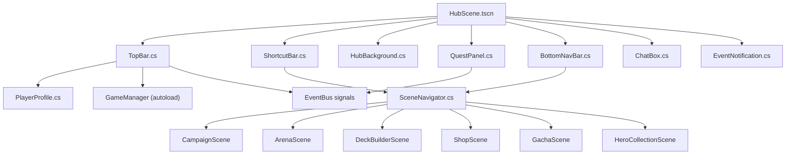

# Phase 2 — Hub Screen (Màn Hình Chính & Navigation)

> **Ngày tạo:** 2026-10-17 | **Ưu tiên:** 🔴 Cao | **Ước lượng:** 4-5 ngày | **Trạng thái:** ✅ Hoàn thành

---

## 🎯 Mục Tiêu

- Xây dựng màn hình chính (Hub) làm điểm xuất phát toàn bộ game
- Tái hiện phong cách MMO: TopBar đầy đủ, icon shortcuts, quest panel, bottom nav bar
- Hoàn thiện hệ thống điều hướng (`SceneNavigator`) cho toàn bộ game
- Tham chiếu: ảnh Long Tướng SV chính TQ (avatar, VIP 11, tiền tệ, icon tròn hàng trên, bottom nav)

---

## 📋 Bảng Tổng Quan Công Việc

| # | Task | File | Ưu tiên | Ước lượng | Trạng thái |
|---|---|---|---|---|---|
| 2.1 | Scene Hub chính | `HubScene.tscn` | 🔴 | 1h | ✅ |
| 2.2 | TopBar | `TopBar.cs` | 🔴 | 2h | ✅ |
| 2.3 | ShortcutBar (icon tròn) | `ShortcutBar.cs` | 🔴 | 2h | ✅ |
| 2.4 | BottomNavBar | `BottomNavBar.cs` | 🔴 | 2h | ✅ |
| 2.5 | QuestPanel | `QuestPanel.cs` | 🟡 | 2h | ✅ |
| 2.6 | WorldBackground (nền động) | `HubBackground.cs` | 🟡 | 2h | ✅ |
| 2.7 | ChatBox | `ChatBox.cs` | 🟢 | 2h | ✅ |
| 2.8 | EventNotification | `EventNotification.cs` | 🟡 | 1.5h | ✅ |
| 2.9 | PlayerProfile data class | `PlayerProfile.cs` | 🔴 | 1h | ✅ |
| 2.10 | SceneNavigator hoàn chỉnh | `SceneNavigator.cs` | 🔴 | 2h | ✅ |
| 2.11 | EventBus signals Hub | `EventBus.cs` | 🔴 | 0.5h | ✅ |
| 2.12 | Assets UI hub/ | `assets/ui/hub/` | 🔴 | 3h | ✅ |

---

## 📁 Sơ Đồ Quan Hệ File

---

## ✅ Chi Tiết Từng Task

### Task 2.1 — Tạo `HubScene.tscn`

- [x] Tạo file: `features/hub/HubScene.tscn` & `HubController.cs`
- [x] Root node: `Control` (full screen)
- [x] Thêm layer nền: `HubBackground` (z-index = 0)
- [x] Thêm `TopBar` (Anchor: Top, height 60px, z-index = 10)
- [x] Thêm `ShortcutBar` (dưới TopBar, height 76px, z-index = 10)
- [x] Thêm `QuestPanel` (Anchor: Right, width 250px, z-index = 10)
- [x] Thêm `BottomNavBar` (Anchor: Bottom, height 68px, z-index = 10)
- [x] Thêm `ChatBox` (bottom-left, trên BottomNavBar, width 360px, height 130px)
- [x] Thêm `EventNotification` (popup overlay, z-index = 25)
- [x] Set scene này là **Main Scene** trong `project.godot`

---

### Task 2.2 — Tạo `TopBar.cs`

- [x] Tạo file: `features/hub/ui/TopBar.cs` (extends `PanelContainer`)
- [x] Sub-nodes trái (avatar khu vực):
  - [x] `TextureButton AvatarButton` — click mở Hero Detail của nhân vật chính
  - [x] `TextureRect FrameDecoration` — viền trang trí xung quanh avatar
  - [x] `Label PlayerNameLabel` — tên nhân vật (font pixel trắng, bold)
  - [x] `TextureRect VipBadge` — badge VIP 1-15 (texture theo cấp VIP)
  - [x] `Label LevelLabel` — "Lv.80"
  - [x] `Label TitleLabel` — danh hiệu "[Địa Chủ]" (màu vàng)
- [x] Sub-nodes giữa (tiền tệ):
  - [x] `HBoxContainer CurrencyBar`:
    - [x] Icon vàng + `Label GoldLabel` — "214.5 vạn"
    - [x] Icon kim cương + `Label DiamondLabel` — "15 vạn"
    - [x] Icon lệnh + `Label StaminaLabel` + `ProgressBar StaminaBar` — "100/145"
    - [x] Timer `StaminaTimer` — đếm ngược hồi lệnh (hiện "24:43")
- [x] Sub-nodes phải (shortcut icons nhỏ):
  - [x] Icon cài đặt, icon thông báo / thư
- [x] `void UpdateProfile(PlayerProfile profile)`: Cập nhật toàn bộ UI từ data
- [x] `void UpdateCurrency(int gold, int diamond, int stamina, int maxStamina)`: Cập nhật tiền
- [x] `void StartStaminaTimer(int secondsRemaining)`: Đếm ngược hồi lệnh
- [x] Kết nối signal `EventBus.GoldChanged`, `EventBus.DiamondChanged`, `EventBus.StaminaChanged`

---

### Task 2.3 — Tạo `ShortcutBar.cs`

- [x] Tạo file: `features/hub/ui/ShortcutBar.cs` (extends `HBoxContainer`)
- [x] 10 icon tròn (mỗi icon là `ShortcutButton` node riêng):
  - [x] **Hoạt Động** → mở EventList popup
  - [x] **Sự Kiện** → mở EventDetail popup
  - [x] **Khánh Điển** → mở Achievement popup
  - [x] **Đấu Giá** → mở AuctionScene
  - [x] **Quốc Gia** → mở NationScene
  - [x] **Tuyệt Lộ** → mở QuestSpecialScene
  - [x] **Long Điện** → mở DragonPalaceScene
  - [x] **Di Cảnh** → mở ExploreScene
  - [x] **Tu Luyện** → mở TrainingScene
  - [x] **Donate & Quà** → mở DonateScene
- [x] Mỗi `ShortcutButton`:
  - [x] `TextureRect IconCircle` — nền tròn (màu theo loại)
  - [x] `TextureRect IconImage` — icon bên trong
  - [x] `Label NameLabel` — tên ngắn bên dưới (font 11px)
  - [x] `Badge NotificationDot` — chấm đỏ khi có nội dung mới
- [x] `void SetNotification(string shortcutId, bool hasNew)`: Bật/tắt chấm đỏ

---

### Task 2.4 — Tạo `BottomNavBar.cs`

- [x] Tạo file: `features/hub/ui/BottomNavBar.cs` (extends `PanelContainer`)
- [x] 11 tab icon hàng ngang (scroll ngang nếu cần):
  - [x] **Võ Tướng** (`icon_hero.png`) → `SceneNavigator.GoToHeroCollection()`
  - [x] **Bảo Vật** (`icon_item.png`) → mở InventoryScene
  - [x] **Thí Đấu** (`icon_arena.png`) → `SceneNavigator.GoToArena()`
  - [x] **Địa Chỉ** (`icon_map.png`) → `SceneNavigator.GoToCampaign()`
  - [x] **Túi** (`icon_bag.png`) → mở BagScene
  - [x] **Bảo Thành / Bang Hội** (`icon_guild.png`) → `SceneNavigator.GoToGuild()`
  - [x] **Võ Thành** (`icon_pvp.png`) → mở RankArenaScene
  - [x] **Linh Thú** (`icon_pet.png`) → mở PetScene
  - [x] **Cường Hóa** (`icon_upgrade.png`) → mở UpgradeScene
  - [x] **Quân Đoàn** (`icon_formation.png`) → `SceneNavigator.GoToFormationSelector("hub")`
  - [x] **Thú Cưỡi** (`icon_wedding.png`) → mở WeddingScene
- [x] Mỗi tab:
  - [x] `TextureRect IconRect`
  - [x] `Label TabLabel`
  - [x] `Panel ActiveIndicator` — thanh sáng dưới khi tab active
  - [x] `Badge NotificationBadge` — badge số (vd: "3" nhiệm vụ mới)
- [x] `void SetActiveTab(string tabId)`: Highlight tab đang active

---

### Task 2.5 — Tạo `QuestPanel.cs`

- [x] Tạo file: `features/hub/ui/QuestPanel.cs` (extends `PanelContainer`)
- [x] Sub-nodes:
  - [x] `Label TitleLabel` — "NHIỆM VỤ ▼" (có thể thu gọn)
  - [x] `VBoxContainer QuestList` — danh sách nhiệm vụ
  - [x] Mỗi quest item:
    - [x] `Label QuestNameLabel` — tên nhiệm vụ (vd: "[Ải] Tuần Tra Kinh Đô")
    - [x] `Label QuestDescLabel` — mô tả ngắn (vd: "Vượt ải Tuần Tra 1 lần")
    - [x] `ProgressBar QuestProgress` — tiến độ (vd: 0/1)
    - [x] `Label RewardLabel` — phần thưởng (vd: "330 EXP, 30 vạn Bạc")
    - [x] `Button ClaimButton` — nút Nhận khi hoàn thành
- [x] `void LoadDailyQuests(List<QuestData> quests)`: Render danh sách
- [x] `void UpdateQuestProgress(string questId, int current, int target)`: Cập nhật tiến độ
- [x] `void MarkQuestComplete(string questId)`: Enable nút Nhận, đổi màu
- [x] Kết nối `EventBus.QuestProgressUpdated`, `EventBus.QuestCompleted`
- [x] Panel có thể thu gọn (click tiêu đề)

---

### Task 2.6 — Tạo `HubBackground.cs`

- [x] Tạo file: `features/hub/HubBackground.cs` (extends `Node2D`)
- [x] `Sprite2D BackgroundSprite` — nền cảnh hoàng cung / đại bản doanh (`hub_courtyard_bg.png`)
- [x] `CpuParticles2D AmbientEffects` — hiệu ứng ambient (tàn lửa, lá bay)
- [x] `Node2D PlayerCharacter` — nhân vật player đứng ở hub (idle animation AnimatedSprite2D)
- [x] `Node2D NpcContainer` — 2 NPC tướng nổi tiếng (Quan Vũ, Điêu Thuyền) đứng xung quanh
- [x] Parallax scrolling nhẹ khi di chuột qua màn hình
- [x] Tương tác thoại khi click vào tướng

---

### Task 2.7 — Tạo `ChatBox.cs`

- [x] Tạo file: `features/hub/ui/ChatBox.cs` (extends `PanelContainer`)
- [x] `ScrollContainer ChatScroll` — cuộn lên xem tin cũ
- [x] `VBoxContainer MessageList` — danh sách tin nhắn
- [x] `LineEdit InputField` — ô nhập tin nhắn
- [x] `Button SendButton` — nút gửi
- [x] `OptionButton ChannelSelector` — chọn kênh: Thế giới / Bang hội / Hệ thống
- [x] Mỗi tin nhắn:
  - [x] `[Tên kênh][Tên người chơi]: nội dung` — màu theo kênh
- [x] `void AddMessage(string sender, string message, string channel)`: Thêm tin
- [x] Auto-scroll xuống khi có tin mới
- [x] Kết nối `EventBus.ChatMessageReceived`

---

### Task 2.8 — Tạo `EventNotification.cs`

- [x] Tạo file: `features/hub/EventNotification.cs` (extends `CanvasLayer`)
- [x] Hiển thị popup sự kiện đang diễn ra (banner hình ảnh + nút Tham gia)
- [x] `ShowEventBanner(EventData eventData)`: Slide-in từ phải
- [x] `DismissEventBanner()`: Slide-out hoặc close button
- [x] Queue tối đa 3 banner, hiện lần lượt
- [x] Popup thông báo hệ thống nhỏ (toast): "Chào mừng Chúa Công!", "Nhiệm vụ hoàn thành!"
- [x] `ShowToast(string message, float duration = 3.0f)`: Xuất hiện góc trên phải, tự ẩn

---

### Task 2.9 — Tạo `PlayerProfile.cs`

- [x] Tạo file: `data/resources/PlayerProfile.cs` (extends `Resource`)
- [x] Fields đầy đủ: PlayerId, PlayerName, Level, VipLevel, CurrentTitle, Gold, Diamond, Stamina, MaxStamina, StaminaRefillTime, GuildId, GuildName, AvatarHeroId, ArenaRank, TowerMaxFloor, OwnedHeroIds.
- [x] `static PlayerProfile CreateDefault()`: Tạo profile mặc định
- [x] `void Save()` / `static PlayerProfile Load()`: Lưu/nạp từ file JSON local

---

### Task 2.10 — Hoàn thiện `SceneNavigator.cs`

- [x] Tạo file hoàn chỉnh: `core/navigation/SceneNavigator.cs`
- [x] Quản lý scene stack: `Stack<string> _sceneHistory`
- [x] Implement đầy đủ:
  - `GoToHub()`
  - `GoToFormationSelector(string context)`
  - `GoToBattle(formation, config)`
  - `GoToCampaign()`
  - `GoToArena()`
  - `GoToTower()`
  - `GoToLabyrinth()`
  - `GoToGuild()`
  - `GoToHeroCollection()`
  - `GoToShop()`
  - `GoToGacha()`
  - `GoBack()`
- [x] Transition effect: fade out/in ngắn (0.12s) mượt mà giữa các scene
- [x] `SetBattleContext(string context)`, `GetCurrentBattleConfig()`

---

### Task 2.11 — Bổ sung EventBus Signals cho Hub

- [x] Thêm vào `core/autoload/EventBus.cs`:
  - Player & Profile: `ProfileLoaded`, `LevelUp`, `VipLevelChanged`, `TitleChanged`
  - Currency: `GoldChanged`, `DiamondChanged`, `StaminaChanged`, `StaminaTimerTick`
  - Navigation: `SceneChangeRequested`, `BackRequested`
  - Quest: `QuestProgressUpdated`, `QuestCompleted`, `DailyQuestReset`
  - Notification & Chat: `SystemNotification`, `ChatMessageReceived`, `EventBannerShow`

---

### Task 2.12 — Assets UI `assets/ui/hub/`

- [x] `topbar_bg.png` (1280x64)
- [x] `topbar_avatar_frame.png` (72x72)
- [x] `vip_badge_1.png` → `vip_badge_15.png` (48x24)
- [x] `currency_icon_gold.png` (28x28)
- [x] `currency_icon_diamond.png` (28x28)
- [x] `currency_icon_stamina.png` (28x28)
- [x] `shortcut_circle_frame.png` (64x64)
- [x] `shortcut_notification_dot.png` (16x16)
- [x] 10 circular shortcut icons (Hoạt Động, Sự Kiện, Khánh Điển, Đấu Giá, Quốc Gia, Tuyệt Lộ, Long Điện, Di Cảnh, Tu Luyện, Donate & Quà)
- [x] `bottom_nav_bg.png` (1280x70)
- [x] `bottom_nav_tab_active.png` (80x4)
- [x] 11 bottom nav icons (Võ Tướng, Bảo Vật, Thí Đấu, Địa Chỉ, Túi, Bang Hội, Võ Thành, Linh Thú, Cường Hóa, Quân Đoàn, Thú Cưỡi)
- [x] `notification_badge_bg.png` (24x24)
- [x] `quest_panel_bg.png` (260x380)
- [x] `quest_item_bg.png` (240x80)
- [x] `chat_box_bg.png` (360x130)
- [x] `event_banner_frame.png` (420x180)
- [x] `hub_courtyard_bg.png` (1280x720)

---

## ✅ Tiêu Chí Hoàn Thành

- [x] Hub Scene là Main Scene, game khởi động vào Hub
- [x] TopBar hiển thị đúng: avatar, tên, level, VIP, vàng, kim, lệnh
- [x] 10 icon shortcuts hiển thị đúng, click tương tác chính xác
- [x] BottomNavBar đầy đủ 11 tab, highlight tab active
- [x] QuestPanel hiển thị 3 nhiệm vụ hàng ngày, theo dõi tiến độ và nhận thưởng
- [x] Nút tab "Quân Đoàn" → mở Formation Selector
- [x] Nút tab "Địa Chỉ" → mở Campaign Map
- [x] `SceneNavigator.GoBack()` quay lại màn hình trước mượt mà
- [x] Transition fade hoạt động mượt
- [x] Không crash khi navigate qua lại nhiều lần
