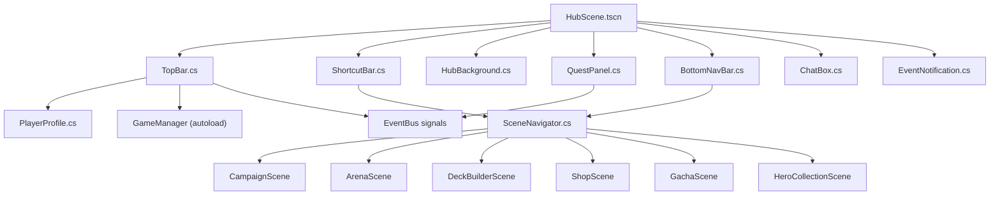

# Phase 2 — Hub Screen (Màn Hình Chính & Navigation)

> **Ngày tạo:** 2026-10-17 | **Ưu tiên:** 🔴 Cao | **Ước lượng:** 4-5 ngày | **Trạng thái:** ❌ Chưa bắt đầu

---

## 🎯 Mục Tiêu

- Xây dựng màn hình chính (Hub) làm điểm xuất phát toàn bộ game
- Tái hiện phong cách MMO: TopBar đầy đủ, icon shortcuts, quest panel, bottom nav bar
- Hoàn thiện hệ thống điều hướng (`SceneNavigator`) cho toàn bộ game
- Tham chiếu: ảnh Long Tướng SV chính TQ (avatar, VIP 11, tiền tệ, icon tròn hàng trên, bottom nav)

---

## 📋 Bảng Tổng Quan Công Việc

| # | Task | File | Ưu tiên | Ước lượng | Trạng thái |
|---|---|---|---|---|---|
| 2.1 | Scene Hub chính | `HubScene.tscn` | 🔴 | 1h | ❌ |
| 2.2 | TopBar | `TopBar.cs` | 🔴 | 2h | ❌ |
| 2.3 | ShortcutBar (icon tròn) | `ShortcutBar.cs` | 🔴 | 2h | ❌ |
| 2.4 | BottomNavBar | `BottomNavBar.cs` | 🔴 | 2h | ❌ |
| 2.5 | QuestPanel | `QuestPanel.cs` | 🟡 | 2h | ❌ |
| 2.6 | WorldBackground (nền động) | `HubBackground.cs` | 🟡 | 2h | ❌ |
| 2.7 | ChatBox | `ChatBox.cs` | 🟢 | 2h | ❌ |
| 2.8 | EventNotification | `EventNotification.cs` | 🟡 | 1.5h | ❌ |
| 2.9 | PlayerProfile data class | `PlayerProfile.cs` | 🔴 | 1h | ❌ |
| 2.10 | SceneNavigator hoàn chỉnh | `SceneNavigator.cs` | 🔴 | 2h | ❌ |
| 2.11 | EventBus signals Hub | `EventBus.cs` | 🔴 | 0.5h | ❌ |
| 2.12 | Assets UI hub/ | `assets/ui/hub/` | 🔴 | 3h | ❌ |

---

## 📁 Sơ Đồ Quan Hệ File



---

## ✅ Chi Tiết Từng Task

### Task 2.1 — Tạo `HubScene.tscn`

- [ ] Tạo file: `features/hub/HubScene.tscn`
- [ ] Root node: `CanvasLayer` → `Control` (full screen)
- [ ] Thêm layer nền: `HubBackground` (z-index = 0)
- [ ] Thêm `TopBar` (Anchor: Top, height 60px, z-index = 10)
- [ ] Thêm `ShortcutBar` (dưới TopBar, height 80px, z-index = 10)
- [ ] Thêm `QuestPanel` (Anchor: Right, width 220px, z-index = 10)
- [ ] Thêm `BottomNavBar` (Anchor: Bottom, height 70px, z-index = 10)
- [ ] Thêm `ChatBox` (bottom-left, trên BottomNavBar, width 350px, height 90px)
- [ ] Thêm `EventNotification` (popup overlay, z-index = 20)
- [ ] Set scene này là **Main Scene** trong `project.godot`

---

### Task 2.2 — Tạo `TopBar.cs`

- [ ] Tạo file: `features/hub/ui/TopBar.cs` (extends `PanelContainer`)
- [ ] Sub-nodes trái (avatar khu vực):
  - [ ] `TextureButton AvatarButton` — click mở Hero Detail của nhân vật chính
  - [ ] `TextureRect FrameDecoration` — viền trang trí xung quanh avatar
  - [ ] `Label PlayerNameLabel` — tên nhân vật (font pixel trắng, bold)
  - [ ] `TextureRect VipBadge` — badge VIP 1-15 (texture theo cấp VIP)
  - [ ] `Label LevelLabel` — "Lv.80"
  - [ ] `Label TitleLabel` — danh hiệu "[Địa Chủ]" (màu vàng)
- [ ] Sub-nodes giữa (tiền tệ):
  - [ ] `HBoxContainer CurrencyBar`:
    - [ ] Icon vàng + `Label GoldLabel` — "214537 vạn"
    - [ ] Icon kim cương + `Label DiamondLabel` — "150 vạn"
    - [ ] Icon lệnh + `Label StaminaLabel` + `ProgressBar StaminaBar` — "100/145"
    - [ ] Timer `StaminaTimer` — đếm ngược hồi lệnh (hiện "24:43")
- [ ] Sub-nodes phải (shortcut icons nhỏ):
  - [ ] Icon bản đồ, icon cài đặt, icon thông báo
- [ ] `void UpdateProfile(PlayerProfile profile)`: Cập nhật toàn bộ UI từ data
- [ ] `void UpdateCurrency(int gold, int diamond, int stamina, int maxStamina)`: Cập nhật tiền
- [ ] `void StartStaminaTimer(int secondsRemaining)`: Đếm ngược hồi lệnh
- [ ] Kết nối signal `EventBus.GoldChanged`, `EventBus.DiamondChanged`, `EventBus.StaminaChanged`

---

### Task 2.3 — Tạo `ShortcutBar.cs`

- [ ] Tạo file: `features/hub/ui/ShortcutBar.cs` (extends `HBoxContainer`)
- [ ] 10 icon tròn (mỗi icon là `ShortcutButton` node riêng):
  - [ ] **Hoạt Động** → mở EventList popup
  - [ ] **Sự Kiện** → mở EventDetail popup
  - [ ] **Khánh Điển** → mở Achievement popup
  - [ ] **Đấu Giá** → mở AuctionScene
  - [ ] **Quốc Gia** → mở NationScene
  - [ ] **Tuyệt Lộ** → mở QuestSpecialScene
  - [ ] **Long Điện** → mở DragonPalaceScene
  - [ ] **Di Cảnh** → mở ExploreScene
  - [ ] **Tu Luyện** → mở TrainingScene
  - [ ] **Donate & Quà** → mở DonateScene
- [ ] Mỗi `ShortcutButton`:
  - [ ] `TextureRect IconCircle` — nền tròn (màu theo loại)
  - [ ] `TextureRect IconImage` — icon bên trong
  - [ ] `Label NameLabel` — tên ngắn bên dưới (font 10px)
  - [ ] `Badge NotificationDot` — chấm đỏ khi có nội dung mới
- [ ] `void SetNotification(string shortcutId, bool hasNew)`: Bật/tắt chấm đỏ

---

### Task 2.4 — Tạo `BottomNavBar.cs`

- [ ] Tạo file: `features/hub/ui/BottomNavBar.cs` (extends `PanelContainer`)
- [ ] 11 tab icon hàng ngang (scroll ngang nếu cần):
  - [ ] **Võ Tướng** (`icon_hero.png`) → `SceneNavigator.GoToHeroCollection()`
  - [ ] **Bay Vật** (`icon_item.png`) → mở InventoryScene
  - [ ] **Thí Đấu** (`icon_arena.png`) → `SceneNavigator.GoToArena()`
  - [ ] **Địa Chỉ** (`icon_map.png`) → `SceneNavigator.GoToCampaign()`
  - [ ] **Túi** (`icon_bag.png`) → mở BagScene
  - [ ] **Bảo Thành** (`icon_guild.png`) → `SceneNavigator.GoToGuild()`
  - [ ] **Võ Thành** (`icon_pvp.png`) → mở RankArenaScene
  - [ ] **Linh Thú** (`icon_pet.png`) → mở PetScene
  - [ ] **Cường Hóa** (`icon_upgrade.png`) → mở UpgradeScene
  - [ ] **Quân Đoàn** (`icon_formation.png`) → `SceneNavigator.GoToFormationSelector("hub")`
  - [ ] **Thu Cưới** (`icon_wedding.png`) → mở WeddingScene
- [ ] Mỗi tab:
  - [ ] `TextureRect IconRect`
  - [ ] `Label TabLabel`
  - [ ] `Panel ActiveIndicator` — thanh sáng dưới khi tab active
  - [ ] `Badge NotificationBadge` — badge số (vd: "3" nhiệm vụ mới)
- [ ] `void SetActiveTab(string tabId)`: Highlight tab đang active

---

### Task 2.5 — Tạo `QuestPanel.cs`

- [ ] Tạo file: `features/hub/ui/QuestPanel.cs` (extends `PanelContainer`)
- [ ] Sub-nodes:
  - [ ] `Label TitleLabel` — "NHIỆM VỤ ▼" (có thể thu gọn)
  - [ ] `VBoxContainer QuestList` — danh sách nhiệm vụ
  - [ ] Mỗi quest item:
    - [ ] `Label QuestNameLabel` — tên nhiệm vụ (vd: "[Lv.1] Tuần Tra")
    - [ ] `Label QuestDescLabel` — mô tả ngắn (vd: "Vượt ải Tuần Tra")
    - [ ] `ProgressBar QuestProgress` — tiến độ (vd: 0/1)
    - [ ] `Label RewardLabel` — phần thưởng (vd: "330 EXP, 30 bạc")
    - [ ] `Button ClaimButton` — nút Nhận khi hoàn thành
- [ ] `void LoadDailyQuests(List<QuestData> quests)`: Render danh sách
- [ ] `void UpdateQuestProgress(string questId, int current, int target)`: Cập nhật tiến độ
- [ ] `void MarkQuestComplete(string questId)`: Enable nút Nhận, đổi màu
- [ ] Kết nối `EventBus.QuestProgressUpdated`, `EventBus.QuestCompleted`
- [ ] Panel có thể thu gọn (click tiêu đề)

---

### Task 2.6 — Tạo `HubBackground.cs`

- [ ] Tạo file: `features/hub/HubBackground.cs` (extends `Node2D`)
- [ ] `Sprite2D BackgroundSprite` — nền cảnh (battlefield.png hoặc hub background mới)
- [ ] `AnimatedSprite2D AmbientEffects` — hiệu ứng ambient (mây trôi, lá bay)
- [ ] `Node2D PlayerCharacter` — nhân vật player đứng ở hub (idle animation)
- [ ] `Node2D NpcContainer` — 2-3 NPC (tướng nổi tiếng) đứng xung quanh
- [ ] Parallax scrolling nhẹ khi di chuột qua màn hình
- [ ] Background music: `SoundManager.PlayBgm("hub_theme")`

---

### Task 2.7 — Tạo `ChatBox.cs`

- [ ] Tạo file: `features/hub/ui/ChatBox.cs` (extends `PanelContainer`)
- [ ] `ScrollContainer ChatScroll` — cuộn lên xem tin cũ
- [ ] `VBoxContainer MessageList` — danh sách tin nhắn
- [ ] `LineEdit InputField` — ô nhập tin nhắn
- [ ] `Button SendButton` — nút gửi
- [ ] `OptionButton ChannelSelector` — chọn kênh: Thế giới / Bang hội / Cá nhân
- [ ] Mỗi tin nhắn:
  - [ ] `[Tên guild][Tên người chơi]: nội dung` — màu theo kênh
  - [ ] Click tên → xem profile
- [ ] `void AddMessage(string sender, string message, string channel)`: Thêm tin
- [ ] Auto-scroll xuống khi có tin mới
- [ ] Kết nối `EventBus.ChatMessageReceived`

---

### Task 2.8 — Tạo `EventNotification.cs`

- [ ] Tạo file: `features/hub/EventNotification.cs` (extends `CanvasLayer`)
- [ ] Hiển thị popup sự kiện đang diễn ra (banner hình ảnh + nút Tham gia)
- [ ] `ShowEventBanner(EventData eventData)`: Slide-in từ phải
- [ ] `DismissEventBanner()`: Slide-out hoặc close button
- [ ] Queue tối đa 3 banner, hiện lần lượt
- [ ] Popup thông báo hệ thống nhỏ (toast): "Triệu Hồi Mới Đã Mở!"
- [ ] `ShowToast(string message, float duration = 3.0f)`: Xuất hiện góc trên phải, tự ẩn

---

### Task 2.9 — Tạo `PlayerProfile.cs`

- [ ] Tạo file: `data/resources/PlayerProfile.cs` (extends `Resource`)
- [ ] Fields:
  ```csharp
  public string PlayerId { get; set; }
  public string PlayerName { get; set; }
  public int Level { get; set; }
  public int VipLevel { get; set; }
  public string CurrentTitle { get; set; }  // "[Địa Chủ]"
  public long Gold { get; set; }
  public int Diamond { get; set; }
  public int Stamina { get; set; }
  public int MaxStamina { get; set; }
  public System.DateTime StaminaRefillTime { get; set; }
  public int GuildId { get; set; }
  public string GuildName { get; set; }
  public string AvatarHeroId { get; set; }  // tướng dùng làm avatar
  public int ArenaRank { get; set; }
  public int TowerMaxFloor { get; set; }
  public List<string> OwnedHeroIds { get; set; }
  public List<FormationPreset> SavedFormations { get; set; }
  ```
- [ ] `static PlayerProfile CreateDefault()`: Tạo profile mặc định để test
- [ ] `void Save()` / `static PlayerProfile Load()`: Lưu/nạp từ file JSON local

---

### Task 2.10 — Hoàn thiện `SceneNavigator.cs`

- [ ] Tạo file hoàn chỉnh: `core/navigation/SceneNavigator.cs`
- [ ] Là `Node` singleton (Autoload trong `project.godot`)
- [ ] Quản lý scene stack: `Stack<string> _sceneHistory`
- [ ] Implement đầy đủ:
  ```csharp
  public void GoToHub();
  public void GoToFormationSelector(string context);
  public void GoToBattle(FormationData formation, BattleConfig config);
  public void GoToCampaign();
  public void GoToArena();
  public void GoToTower();
  public void GoToLabyrinth();
  public void GoToGuild();
  public void GoToHeroCollection();
  public void GoToShop();
  public void GoToGacha();
  public void GoBack();
  ```
- [ ] Mỗi GoTo: push scene cũ vào history, load scene mới
- [ ] `GoBack()`: pop scene từ history
- [ ] Transition effect: fade out/in ngắn (0.15s) giữa các scene
- [ ] `void SetBattleContext(string context)`: Lưu ngữ cảnh (campaign/arena)
- [ ] `BattleConfig GetCurrentBattleConfig()`: Trả về config trận hiện tại

---

### Task 2.11 — Bổ sung EventBus Signals cho Hub

```csharp
// Thêm vào core/autoload/EventBus.cs

// Player & Profile
[Signal] public delegate void ProfileLoadedEventHandler();
[Signal] public delegate void LevelUpEventHandler(int newLevel);
[Signal] public delegate void VipLevelChangedEventHandler(int vipLevel);
[Signal] public delegate void TitleChangedEventHandler(string newTitle);

// Currency
[Signal] public delegate void GoldChangedEventHandler(int delta, int total);
[Signal] public delegate void DiamondChangedEventHandler(int delta, int total);
[Signal] public delegate void StaminaChangedEventHandler(int current, int max);
[Signal] public delegate void StaminaTimerTickEventHandler(int secondsRemaining);

// Navigation
[Signal] public delegate void SceneChangeRequestedEventHandler(string scenePath);
[Signal] public delegate void BackRequestedEventHandler();

// Quest
[Signal] public delegate void QuestProgressUpdatedEventHandler(string questId, int current, int target);
[Signal] public delegate void QuestCompletedEventHandler(string questId);
[Signal] public delegate void DailyQuestResetEventHandler();

// Notification & Chat
[Signal] public delegate void SystemNotificationEventHandler(string title, string body, string type);
[Signal] public delegate void ChatMessageReceivedEventHandler(string sender, string message, string channel);
[Signal] public delegate void EventBannerShowEventHandler(string eventId);
```

---

### Task 2.12 — Assets UI `assets/ui/hub/`

- [ ] `topbar_bg.png` (1920x70) — nền TopBar cổ phong tối màu với hoa văn viền
- [ ] `topbar_avatar_frame.png` (80x80) — khung tròn trang trí cho avatar
- [ ] `vip_badge_1.png` → `vip_badge_15.png` (48x24) — 15 badge VIP
- [ ] `currency_icon_gold.png` (24x24) — icon vàng
- [ ] `currency_icon_diamond.png` (24x24) — icon kim cương
- [ ] `currency_icon_stamina.png` (24x24) — icon lệnh/thể lực
- [ ] `shortcut_circle_frame.png` (64x64) — khung tròn icon shortcut
- [ ] `shortcut_notification_dot.png` (16x16) — chấm đỏ thông báo
- [ ] `bottom_nav_bg.png` (1920x70) — nền BottomNavBar
- [ ] `bottom_nav_tab_active.png` (80x4) — thanh sáng dưới tab active
- [ ] `notification_badge_bg.png` (24x24) — nền badge số đỏ
- [ ] `quest_panel_bg.png` (220x400) — nền Quest Panel
- [ ] `quest_item_bg.png` (200x80) — nền từng item nhiệm vụ
- [ ] `chat_box_bg.png` (350x90) — nền ChatBox
- [ ] `event_banner_frame.png` (400x200) — khung banner sự kiện

---

## ✅ Tiêu Chí Hoàn Thành

- [ ] Hub Scene là Main Scene, game khởi động vào Hub
- [ ] TopBar hiển thị đúng: avatar, tên, level, VIP, vàng, kim, lệnh
- [ ] 10 icon shortcuts hiển thị đúng, click chuyển đúng màn hình
- [ ] BottomNavBar đầy đủ 11 tab, highlight tab active
- [ ] QuestPanel hiển thị 3 nhiệm vụ hàng ngày
- [ ] Nút tab "Quân Đoàn" → mở Formation Selector
- [ ] Nút tab "Địa Chỉ" → mở Campaign Map
- [ ] `SceneNavigator.GoBack()` quay lại màn hình trước
- [ ] Transition fade hoạt động mượt
- [ ] Không crash khi navigate qua lại nhiều lần
