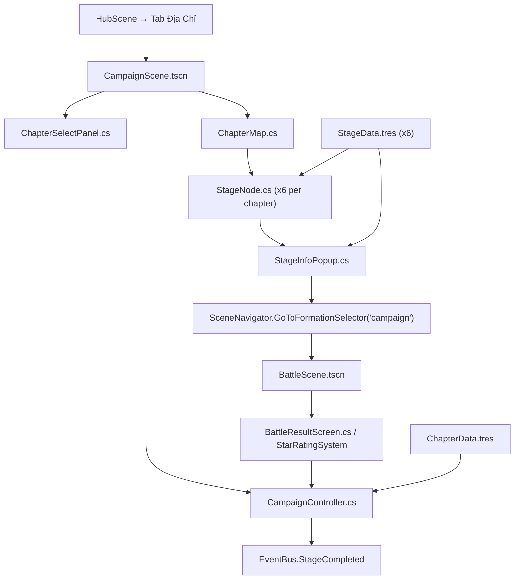

# Phase 3 — Campaign Map (Bản Đồ Chiến Dịch & Ải PvE)

> **Ngày tạo:** 2026-10-17 | **Ưu tiên:** 🟡 Trung | **Ước lượng:** 5-7 ngày | **Trạng thái:** ✅ Hoàn thành 100%

---

## 🎯 Mục Tiêu

- Xây dựng màn hình bản đồ chiến dịch PvE theo chương (Chapters & Stages)
- Hoàn thiện Chapter 1 (5 ải + 1 boss ải) với data `.tres` đầy đủ
- Hệ thống đánh giá 3 sao cho mỗi ải (StarRatingSystem)
- Kết nối: chọn ải → StageInfoPopup → Formation Selector → Battle → trả về kết quả + sao
- Đồng bộ hai chiều với PostgreSQL `campaign_progress` và Docker ASP.NET Core Game Server.

---

## 📋 Bảng Tổng Quan Công Việc

| # | Task | File | Ưu tiên | Ước lượng | Trạng thái |
|---|---|---|---|---|---|
| 3.1 | Scene Campaign | `CampaignScene.tscn` | 🔴 | 1h | ✅ Hoàn thành |
| 3.2 | Controller Campaign | `CampaignController.cs` | 🔴 | 3h | ✅ Hoàn thành |
| 3.3 | Node từng ải | `StageNode.cs` | 🔴 | 2h | ✅ Hoàn thành |
| 3.4 | Bản đồ chapter | `ChapterMap.cs` | 🔴 | 2h | ✅ Hoàn thành |
| 3.5 | Popup info ải | `StageInfoPopup.cs` | 🔴 | 2h | ✅ Hoàn thành |
| 3.6 | Data resource ải | `StageData.cs`, `EnemyEntry.cs` | 🔴 | 1h | ✅ Hoàn thành |
| 3.7 | Data resource chapter | `ChapterData.cs` | 🔴 | 1h | ✅ Hoàn thành |
| 3.8 | Data ải Chapter 1 | `data/database/stages/ch01/` | 🔴 | 3h | ✅ Hoàn thành |
| 3.9 | Hệ thống đánh giá sao | `StarRatingSystem.cs` | 🟡 | 1.5h | ✅ Hoàn thành |
| 3.10 | Màn hình chọn chapter | `ChapterSelectPanel.cs` | 🟡 | 1.5h | ✅ Hoàn thành |
| 3.11 | EventBus signals Campaign | `EventBus.cs` | 🔴 | 0.5h | ✅ Hoàn thành |
| 3.12 | Assets UI campaign | `assets/ui/activities/campaign/` | 🔴 | 2h | ✅ Hoàn thành |

---

## 📁 Sơ Đồ Quan Hệ File

---

## ✅ Chi Tiết Từng Task

### Task 3.1 — Tạo `CampaignScene.tscn`
- [x] Tạo file: `features/campaign/scenes/CampaignScene.tscn`
- [x] Root: `Control` full screen
- [x] `ChapterSelectPanel` — panel chọn chương (slide từ trái)
- [x] `ChapterMap` — hiển thị bản đồ chapter đang chọn
- [x] `StageInfoPopup` — popup ẩn mặc định, hiện khi click ải
- [x] `PanelContainer TopBar` — tên campaign + tổng sao đã đạt
- [x] `Button BackButton` — quay về Hub
- [x] Attach script `CampaignController.cs`

### Task 3.2 — Hoàn thiện `CampaignController.cs`
- [x] `_Ready()`: Load danh sách `ChapterData` từ `data/database/chapters/`
- [x] `_Ready()`: Load progress người chơi từ PostgreSQL / `NetworkManager`
- [x] `LoadChapter(int chapterId)`: Render `ChapterMap` với `StageNode` cho chapter được chọn
- [x] `OnStageNodeClicked(StageData stage)`: Gọi `StageInfoPopup.ShowStage(stage, stars)`
- [x] Xử lý Quét Nhanh (Sweep): Tiêu hao thể lực, nhận Bạc/EXP, sync DB
- [x] `OnBackPressed()`: `SceneNavigator.GoToHub()`

### Task 3.3 — Tạo `StageNode.cs`
- [x] Tạo file: `features/campaign/ui/StageNode.cs`
- [x] Properties: `ChapterId`, `StageId`, `Data`, `BestStars`, `IsUnlocked`, `IsCurrentTarget`
- [x] Hiển thị icon (thường, boss, resource, locked), số ải ("1-1"), 3 sao vàng/xám
- [x] Pulse Tween khi là ải mục tiêu tiếp theo
- [x] Signal `StageClicked(int chapterId, int stageId)`

### Task 3.4 — Tạo `ChapterMap.cs`
- [x] Tạo file: `features/campaign/ui/ChapterMap.cs`
- [x] Layout: Waypoints ngoằn ngoèo chiến thuật
- [x] `Line2D` nối các ải (vàng khi đã mở, xám khi chưa)
- [x] `TextureRect ChapterBackground` nền riêng cho từng chapter

### Task 3.5 — Tạo `StageInfoPopup.cs`
- [x] Tạo file: `features/campaign/ui/StageInfoPopup.cs`
- [x] Header: Tên ải, badge phân loại, nút đóng
- [x] Stats: Lực chiến gợi ý, thể lực tiêu hao
- [x] Enemy preview: Danh sách tướng địch thu nhỏ
- [x] 3 sao điều kiện: Thắng, số tướng sống, số hiệp
- [x] Thưởng vượt ải & Thưởng lần đầu
- [x] Nút Xuất Trận & Nút Quét nhanh

### Task 3.6 & 3.7 — Data Resources
- [x] `data/resources/StageData.cs` & `EnemyEntry.cs`
- [x] `data/resources/ChapterData.cs`

### Task 3.8 — Data Ải Chapter 1
- [x] `stage_01_01.tres` — "Tuần Tra Biên Giới" (Normal)
- [x] `stage_01_02.tres` — "Phục Kích Rừng Trúc" (Normal)
- [x] `stage_01_03.tres` — "Qua Ải Tiểu Bái" (Resource)
- [x] `stage_01_04.tres` — "Tranh Hùng Hạ Binh" (Normal)
- [x] `stage_01_05.tres` — "Cổng Thành Lạc Dương" (Elite)
- [x] `stage_01_boss.tres` — Boss "Đổng Trác — Bạo Quân" (Boss)
- [x] `chapter_01.tres` & `chapter_02.tres`

### Task 3.9 — `StarRatingSystem.cs`
- [x] Tạo file: `features/battle/controllers/StarRatingSystem.cs`
- [x] `CalculateStars(BattleResult result, StageData stageData)`
- [x] `EvaluateStarConditions(BattleResult result, StageData stageData)`

### Task 3.10 — `ChapterSelectPanel.cs`
- [x] Tạo file: `features/campaign/ui/ChapterSelectPanel.cs`
- [x] Scroll danh sách chapter, tiến độ sao, điều kiện mở khóa
- [x] Nút trượt mở / đóng panel

### Task 3.11 — EventBus Signals
- [x] `StageSelected`, `StageStarted`, `StageCompleted`, `ChapterUnlocked`, `FirstClearReward`

### Task 3.12 — Assets UI
- [x] 12 pixel art assets tạo bằng `tools/generate_campaign_assets.py` trong `assets/ui/activities/campaign/`
