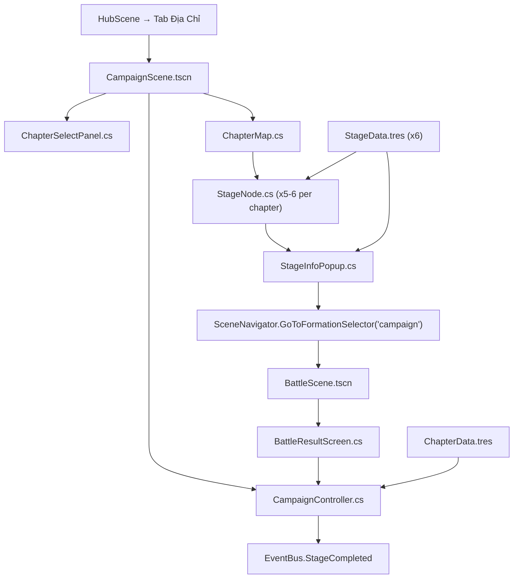

# Phase 3 — Campaign Map (Bản Đồ Chiến Dịch & Ải PvE)

> **Ngày tạo:** 2026-10-17 | **Ưu tiên:** 🟡 Trung | **Ước lượng:** 5-7 ngày | **Trạng thái:** ❌ Chưa bắt đầu

---

## 🎯 Mục Tiêu

- Xây dựng màn hình bản đồ chiến dịch PvE theo chương (Chapters & Stages)
- Hoàn thiện Chapter 1 (5 ải + 1 boss ải) với data `.tres` đầy đủ
- Hệ thống đánh giá 3 sao cho mỗi ải
- Kết nối: chọn ải → Formation Selector → Battle → trả về kết quả + sao

---

## 📋 Bảng Tổng Quan Công Việc

| # | Task | File | Ưu tiên | Ước lượng | Trạng thái |
|---|---|---|---|---|---|
| 3.1 | Scene Campaign | `CampaignScene.tscn` | 🔴 | 1h | ❌ |
| 3.2 | Controller Campaign | `CampaignController.cs` | 🔴 | 3h | ⚠️ Stub |
| 3.3 | Node từng ải | `StageNode.cs` | 🔴 | 2h | ❌ |
| 3.4 | Bản đồ chapter | `ChapterMap.cs` | 🔴 | 2h | ❌ |
| 3.5 | Popup info ải | `StageInfoPopup.cs` | 🔴 | 2h | ❌ |
| 3.6 | Data resource ải | `StageData.cs` | 🔴 | 1h | ❌ |
| 3.7 | Data resource chapter | `ChapterData.cs` | 🔴 | 1h | ❌ |
| 3.8 | Data ải Chapter 1 | `data/database/stages/ch01/` | 🔴 | 3h | ❌ |
| 3.9 | Hệ thống đánh giá sao | `StarRatingSystem.cs` | 🟡 | 1.5h | ❌ |
| 3.10 | Màn hình chọn chapter | `ChapterSelectPanel.cs` | 🟡 | 1.5h | ❌ |
| 3.11 | EventBus signals Campaign | `EventBus.cs` | 🔴 | 0.5h | ❌ |
| 3.12 | Assets UI campaign | `assets/ui/activities/campaign/` | 🔴 | 2h | ❌ |

---

## 📁 Sơ Đồ Quan Hệ File



---

## ✅ Chi Tiết Từng Task

### Task 3.1 — Tạo `CampaignScene.tscn`

- [ ] Tạo file: `features/campaign/CampaignScene.tscn`
- [ ] Root: `Control` full screen
- [ ] `ChapterSelectPanel` — panel chọn chương (slide từ trái)
- [ ] `ChapterMap` — hiển thị bản đồ chapter đang chọn
- [ ] `StageInfoPopup` — popup ẩn mặc định, hiện khi click ải
- [ ] `PanelContainer TopBar` — tên campaign + tổng sao đã đạt
- [ ] `Button BackButton` — quay về Hub
- [ ] Attach script `CampaignController.cs`

---

### Task 3.2 — Hoàn thiện `CampaignController.cs`

**3.2.1 — Khởi tạo & Load**
- [ ] `_Ready()`: Load danh sách `ChapterData` từ `data/database/chapters/`
- [ ] `_Ready()`: Load progress người chơi từ `GameManager` (chapter nào unlock, ải nào đã qua, sao)
- [ ] `LoadChapter(int chapterId)`: Render `ChapterMap` với `StageNode` cho chapter được chọn

**3.2.2 — Xử lý chọn ải**
- [ ] `OnStageNodeClicked(int stageId)`: Lấy `StageData`, gọi `StageInfoPopup.Show(stageData)`
- [ ] Kiểm tra ải có unlock chưa (ải trước phải đã vượt)

**3.2.3 — Sau kết quả trận**
- [ ] `OnBattleResultReceived(bool won, int stars, BattleStats stats)`: Nhận kết quả từ `BattleScene`
- [ ] Nếu thắng: cập nhật sao ải, unlock ải tiếp theo, trao phần thưởng
- [ ] Cập nhật `StageNode` trên bản đồ (render lại sao)
- [ ] Emit `EventBus.StageCompleted(chapterId, stageId, stars)`

**3.2.4 — Navigation**
- [ ] `OnBackPressed()`: `SceneNavigator.GoToHub()`
- [ ] `OnChapterSelected(int chapterId)`: `LoadChapter(chapterId)`

---

### Task 3.3 — Tạo `StageNode.cs`

- [ ] Tạo file: `features/campaign/StageNode.cs` (extends `Button`)
- [ ] Properties: `int ChapterId`, `int StageId`, `StageData Data`, `int BestStars` (0-3), `bool IsUnlocked`
- [ ] Sub-nodes:
  - [ ] `TextureRect StageIcon` — icon ải (thường/boss/resource)
  - [ ] `Label StageNumberLabel` — "1-3"
  - [ ] `HBoxContainer StarsContainer` — 3 sao (filled/empty)
  - [ ] `TextureRect LockOverlay` — lớp tối + icon khóa khi chưa unlock
  - [ ] `TextureRect BossIndicator` — icon skull/crown cho boss ải
  - [ ] `AnimationPlayer PulseAnim` — ải chưa qua: nhấp nháy nhẹ
- [ ] `void SetData(StageData data, int stars, bool isUnlocked)`: Cập nhật hiển thị
- [ ] `void AnimateClear()`: Hiệu ứng sao xuất hiện khi vừa vượt ải
- [ ] Signal `StageClicked(int chapterId, int stageId)`

---

### Task 3.4 — Tạo `ChapterMap.cs`

- [ ] Tạo file: `features/campaign/ChapterMap.cs` (extends `Control`)
- [ ] Layout: các `StageNode` đặt theo đường đi ngoằn ngoèo
- [ ] `Line2D PathLine` — đường nối các ải (màu vàng khi unlock, xám khi chưa)
- [ ] `TextureRect ChapterBackground` — ảnh nền riêng cho từng chapter
- [ ] `void LoadChapter(ChapterData chapter, Dictionary<int, int> starsData)`: Render ải
- [ ] Tự động tính vị trí node theo công thức: snake layout (trái-phải xen kẽ)
- [ ] Scroll nếu chapter có nhiều ải
- [ ] Highlight ải mới unlock: glow animation

---

### Task 3.5 — Tạo `StageInfoPopup.cs`

- [ ] Tạo file: `features/campaign/StageInfoPopup.cs` (extends `PanelContainer`)
- [ ] Sub-nodes:
  - [ ] `Label StageTitleLabel` — "Ải 1-3: Trận Đại Cương"
  - [ ] `Label StageDescLabel` — mô tả lore ngắn
  - [ ] `HBoxContainer EnemyPreview` — 3 portrait kẻ địch thu nhỏ (row 0)
  - [ ] `Label EnemyLevelLabel` — "Địch: Lv.15-20"
  - [ ] `HBoxContainer StarConditions`:
    - [ ] `Label Star1Condition` — "⭐ Chiến thắng"
    - [ ] `Label Star2Condition` — "⭐⭐ Sống sót ≥ 3 tướng"
    - [ ] `Label Star3Condition` — "⭐⭐⭐ Hoàn thành trong 10 lượt"
  - [ ] `VBoxContainer RewardList` — phần thưởng lần đầu (vàng, EXP, item)
  - [ ] `Button ChallengeButton` — "XUẤT TRẬN" (→ Formation Selector)
  - [ ] `Button SweepButton` — "QUÉT" (chỉ enable khi 3 sao, dùng lệnh quét nhanh)
  - [ ] `Button CloseButton` — đóng popup
- [ ] `void Show(StageData data, int currentStars)`: Hiện popup với data
- [ ] Animation: slide up từ dưới, backdrop mờ

---

### Task 3.6 — Tạo `StageData.cs`

- [ ] Tạo file: `data/resources/StageData.cs` (extends `Resource`)
- [ ] Fields:
  ```csharp
  public int ChapterId { get; set; }
  public int StageId { get; set; }
  public string StageName { get; set; }      // "Trận Đại Cương"
  public string Description { get; set; }
  public StageType Type { get; set; }        // Normal, Boss, Resource, Elite
  public int RecommendedPower { get; set; }  // Lực chiến gợi ý
  public int StaminaCost { get; set; }       // Lệnh tiêu hao
  // Đội địch
  public List<EnemyEntry> EnemyFormation { get; set; } // heroId + row + col
  // Phần thưởng lần đầu
  public int FirstClearGold { get; set; }
  public int FirstClearExp { get; set; }
  public List<string> FirstClearItems { get; set; }
  // Phần thưởng thông thường (mỗi lần thắng)
  public int NormalGold { get; set; }
  public int NormalExp { get; set; }
  // Điều kiện sao
  public int Star2Condition { get; set; }    // Số tướng sống sót tối thiểu
  public int Star3Condition { get; set; }    // Số lượt tối đa
  ```
- [ ] `EnemyEntry`: `string HeroId`, `int Row`, `int Col`, `int OverrideLevel` (0 = dùng level mặc định)

---

### Task 3.7 — Tạo `ChapterData.cs`

- [ ] Tạo file: `data/resources/ChapterData.cs` (extends `Resource`)
- [ ] Fields:
  ```csharp
  public int ChapterId { get; set; }
  public string ChapterName { get; set; }   // "Chương 1: Khởi Binh Đại Hán"
  public string BackgroundImage { get; set; } // path ảnh nền bản đồ
  public string BgmTrack { get; set; }      // tên track nhạc nền
  public List<string> StagePaths { get; set; } // paths đến StageData.tres
  public int TotalStars { get; set; }       // tổng số sao tối đa
  public int UnlockRequirement { get; set; } // sao Chapter trước cần để unlock
  ```

---

### Task 3.8 — Data Ải Chapter 1

Tạo 6 file `.tres` trong `data/database/stages/ch01/`:

**stage_01_01.tres** — "Tuần Tra Biên Giới"
- [ ] Địch: 3 lính thường (Lv.5), formation row 0/1 đơn giản
- [ ] Stamina: 3 lệnh | Gold thường: 200 | EXP: 100
- [ ] Sao 1: Thắng | Sao 2: ≥3 sống | Sao 3: ≤5 lượt

**stage_01_02.tres** — "Phục Kích Rừng Trúc"
- [ ] Địch: 4 lính (Lv.7), có 1 궁수 (cung thủ hậu)
- [ ] Stamina: 3 | Gold: 250 | EXP: 120
- [ ] Sao 3: ≤6 lượt

**stage_01_03.tres** — "Qua Ải Tiểu Bái"
- [ ] Địch: 5 lính (Lv.10), có 1 Tiền phong mạnh
- [ ] Stamina: 4 | Gold: 300 | EXP: 150

**stage_01_04.tres** — "Tranh Hùng Hạ Binh"
- [ ] Địch: 5 (Lv.12), có 1 quân sư hỗ trợ
- [ ] Stamina: 4 | Gold: 350 | EXP: 180

**stage_01_05.tres** — "Cổng Thành Lạc Dương"
- [ ] Địch: 5 (Lv.15), đội hình cân bằng đầy đủ
- [ ] Stamina: 5 | Gold: 400 | EXP: 200

**stage_01_boss.tres** — Boss "Đổng Trác — Bạo Quân"
- [ ] Địch: Boss Đổng Trác (Lv.18, HP x2) + 4 vệ binh
- [ ] Type: Boss | Stamina: 6 | Gold: 800 | EXP: 500
- [ ] First Clear: unlock Chapter 2, +5 Kim Cương

---

### Task 3.9 — `StarRatingSystem.cs`

- [ ] Tạo file: `features/battle/controllers/StarRatingSystem.cs`
- [ ] `int CalculateStars(BattleResult result, StageData stageData)`:
  - Sao 1: `result.Won == true`
  - Sao 2: `result.Won && result.SurvivingHeroes >= stageData.Star2Condition`
  - Sao 3: `result.Won && result.TurnCount <= stageData.Star3Condition`
- [ ] `BattleResult` struct:
  ```csharp
  public bool Won;
  public int SurvivingHeroes;
  public int TurnCount;
  public int TotalDamage;
  public float TimeTaken; // seconds
  ```
- [ ] Kết nối với `BattleManager.OnBattleEnd` để tính toán và emit signal

---

### Task 3.10 — `ChapterSelectPanel.cs`

- [ ] Tạo file: `features/campaign/ChapterSelectPanel.cs` (extends `PanelContainer`)
- [ ] `ScrollContainer` với `VBoxContainer` danh sách chapter
- [ ] Mỗi chapter item:
  - [ ] Tên chapter
  - [ ] Progress sao: "8/18 ⭐"
  - [ ] Lock nếu chưa đủ điều kiện
  - [ ] Màu/icon riêng theo chapter (lửa, băng, rừng, sa mạc...)
- [ ] Click chapter → `CampaignController.LoadChapter(chapterId)`
- [ ] Có thể collapse/expand bằng cách click header

---

### Task 3.11 — EventBus Signals Campaign

```csharp
// Thêm vào EventBus.cs
[Signal] public delegate void StageSelectedEventHandler(int chapterId, int stageId);
[Signal] public delegate void StageStartedEventHandler(int chapterId, int stageId);
[Signal] public delegate void StageCompletedEventHandler(int chapterId, int stageId, int stars);
[Signal] public delegate void ChapterUnlockedEventHandler(int chapterId);
[Signal] public delegate void FirstClearRewardEventHandler(int stageId, int gold, int diamond);
```

---

### Task 3.12 — Assets UI `assets/ui/activities/campaign/`

- [ ] `stage_node_normal.png` (80x80) — icon ải thường (lá cờ)
- [ ] `stage_node_boss.png` (80x80) — icon boss (hộp sọ / vương miện)
- [ ] `stage_node_resource.png` (80x80) — icon phó bản tài nguyên (túi vàng)
- [ ] `stage_node_locked.png` (80x80) — icon ải khóa (khóa + mờ)
- [ ] `stage_path_line.png` — texture đường đi nối ải
- [ ] `star_filled.png` (24x24) — sao vàng
- [ ] `star_empty.png` (24x24) — sao xám
- [ ] `chapter_bg_ch01.png` — nền bản đồ Chapter 1 (Đại Hán)
- [ ] `chapter_bg_ch02.png` — nền Chapter 2 (Xích Bích)
- [ ] `sweep_button.png` — nút quét nhanh
- [ ] `challenge_button.png` — nút Xuất Trận

---

## ✅ Tiêu Chí Hoàn Thành

- [ ] Campaign Scene mở từ Hub → Tab "Địa Chỉ"
- [ ] 6 ải Chapter 1 hiển thị đúng trên bản đồ
- [ ] Click ải mở popup đầy đủ: địch preview, sao điều kiện, phần thưởng
- [ ] Vượt ải → đúng Formation Selector → đúng Battle với đội địch đã config
- [ ] Sau thắng: cập nhật sao đúng điều kiện, unlock ải tiếp theo
- [ ] Trao phần thưởng (vàng, EXP) đúng sau mỗi lần thắng
- [ ] First Clear bonus (Kim Cương) chỉ trao 1 lần
- [ ] Ải chưa unlock: disable click, hiện khóa
- [ ] Boss ải hiển thị icon đặc biệt, drop phần thưởng cao hơn
- [ ] Quay về Hub không mất progress
