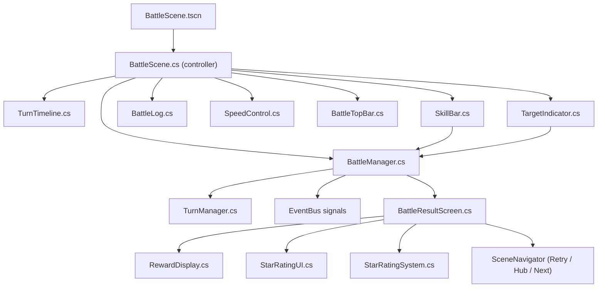

# Phase 4 — Battle HUD Polish (Giao Diện Trận Đấu Hoàn Chỉnh)

> **Ngày tạo:** 2026-10-17 | **Ưu tiên:** 🟡 Trung | **Ước lượng:** 3-4 ngày | **Trạng thái:** ❌ Chưa bắt đầu

---

## 🎯 Mục Tiêu

- Bổ sung đầy đủ HUD trận đấu: Timeline thứ tự lượt, SkillBar, BattleLog, SpeedControl
- Thêm chế độ Thủ công (Manual) vs Tự động (Auto)
- Màn hình kết quả trận (BattleResultScreen) với sao, thống kê, phần thưởng
- Bổ sung TargetIndicator, AoE highlight khi chọn kỹ năng

---

## 📋 Bảng Tổng Quan Công Việc

| # | Task | File | Ưu tiên | Ước lượng | Trạng thái |
|---|---|---|---|---|---|
| 4.1 | Turn Timeline | `TurnTimeline.cs` | 🔴 | 2h | ❌ |
| 4.2 | Skill Bar | `SkillBar.cs` | 🔴 | 2h | ❌ |
| 4.3 | Battle Log | `BattleLog.cs` | 🟡 | 1.5h | ❌ |
| 4.4 | Speed Control | `SpeedControl.cs` | 🔴 | 1h | ❌ |
| 4.5 | Battle Top Bar | `BattleTopBar.cs` | 🟡 | 1h | ❌ |
| 4.6 | Target Indicator | `TargetIndicator.cs` | 🟡 | 1.5h | ❌ |
| 4.7 | Auto/Manual Toggle | trong `BattleScene.cs` | 🔴 | 1h | ❌ |
| 4.8 | Battle Result Screen | `BattleResultScreen.cs` | 🔴 | 2.5h | ❌ |
| 4.9 | Reward Display | `RewardDisplay.cs` | 🟡 | 1.5h | ❌ |
| 4.10 | Star Rating UI | `StarRatingUI.cs` | 🟡 | 1h | ❌ |
| 4.11 | EventBus signals Battle | `EventBus.cs` | 🔴 | 0.5h | ❌ |
| 4.12 | Assets UI battle/ | `assets/ui/battle/` | 🔴 | 2h | ❌ |

---

## 📁 Sơ Đồ Quan Hệ File



---

## ✅ Chi Tiết Từng Task

### Task 4.1 — Tạo `TurnTimeline.cs`

- [ ] Tạo file: `features/battle/ui/TurnTimeline.cs` (extends `HBoxContainer`)
- [ ] Hiển thị danh sách avatar tướng theo thứ tự lượt đánh (tính từ `TurnManager`)
- [ ] Sub-nodes:
  - [ ] `Label RoundLabel` — "Round 2"
  - [ ] `ScrollContainer AvatarScroll` — cuộn ngang
  - [ ] Mỗi slot: `TextureRect Avatar` (40x40) + viền màu (xanh = ta, đỏ = địch)
  - [ ] Slot đầu tiên (lượt hiện tại): to hơn (50x50), có glow animation
- [ ] `void UpdateTimeline(List<BattleHero> turnOrder)`: Render lại danh sách
- [ ] Khi lượt chuyển: slide-scroll sang trái, slot mới xuất hiện từ phải
- [ ] Tướng chết: avatar bị dim + strikethrough
- [ ] Tướng bị stun: icon dây xích nhỏ góc dưới avatar
- [ ] Kết nối `EventBus.HeroTurnStarted`, `EventBus.HeroTurnEnded`

---

### Task 4.2 — Tạo `SkillBar.cs`

- [ ] Tạo file: `features/battle/ui/SkillBar.cs` (extends `HBoxContainer`)
- [ ] 3 nút kỹ năng thường + 1 nút Nộ Chiêu:
  - [ ] `SkillButton[0..2]` — kỹ năng 1, 2, 3
  - [ ] `RageButton` — nút Nộ Chiêu (to hơn, nằm phải nhất)
- [ ] Mỗi `SkillButton`:
  - [ ] `TextureRect SkillIcon` — icon kỹ năng
  - [ ] `Label SkillNameLabel` — tên kỹ năng ngắn
  - [ ] `Panel CooldownOverlay` — lớp xám mờ + `Label CooldownLabel` khi đang hồi
  - [ ] `Label MoraleCostLabel` — "💢 30" (nộ cần để dùng)
  - [ ] Tooltip khi hover: mô tả kỹ năng đầy đủ, target type, sát thương
- [ ] `RageButton`:
  - [ ] `TextureRect RageIcon` — icon rực lửa
  - [ ] `AnimationPlayer GlowAnim` — glow liên tục khi nộ đầy
  - [ ] Disable (dim) khi nộ < 100%
  - [ ] Scale pulse animation khi enable
- [ ] `void LoadSkills(BattleHero hero)`: Cập nhật icon + tên theo tướng đang lượt
- [ ] `void UpdateSkillCooldowns(Dictionary<int, int> cooldowns)`: Hiện cooldown số lượt
- [ ] `void UpdateRageState(int currentMorale, int maxMorale)`: Enable/disable Rage button
- [ ] Chỉ hiện trong Manual Mode; ẩn hoàn toàn trong Auto Mode
- [ ] Signal `SkillChosen(int skillIndex)`, `RageSkillChosen()`

---

### Task 4.3 — Tạo `BattleLog.cs`

- [ ] Tạo file: `features/battle/ui/BattleLog.cs` (extends `PanelContainer`)
- [ ] `ScrollContainer LogScroll` — cuộn lên xem lịch sử
- [ ] `VBoxContainer LogList` — danh sách dòng log
- [ ] `void AddEntry(string message, LogType type)`: Thêm dòng mới
  - `LogType`: Normal, Crit, Miss, Heal, StatusEffect, RoundStart, BattleEnd
- [ ] Format dòng log:
  - Normal: `"Triệu Tử Long chém Lữ Bố -2,400 ⚔️"`
  - Crit: `"💥 BẠO KÍCH! Triệu Tử Long -4,800!"` (màu đỏ)
  - Heal: `"Gia Cát Lượng hồi cho đội +800 HP 💚"` (màu xanh)
  - Miss: `"Lữ Bố né tránh! ✨"` (màu xám)
  - RoundStart: `"═══ Round 2 ═══"` (màu vàng, center)
- [ ] Auto-scroll xuống khi log đầy
- [ ] Tối đa 50 dòng lịch sử (xóa cũ khi vượt)
- [ ] Toggle show/hide bằng nút nhỏ (thu nhỏ để không che màn hình)
- [ ] Kết nối `EventBus.BattleLogEntryAdded`

---

### Task 4.4 — Tạo `SpeedControl.cs`

- [ ] Tạo file: `features/battle/ui/SpeedControl.cs` (extends `HBoxContainer`)
- [ ] 4 nút: **x1** / **x2** / **x4** / **⏸**
- [ ] Click x1/x2/x4: đặt `Engine.TimeScale = 1.0f / 2.0f / 4.0f`
- [ ] Click ⏸: `GetTree().Paused = true`, nút đổi thành ▶ (tiếp tục)
- [ ] Active button: highlight viền vàng
- [ ] Default: x1
- [ ] Trong Manual Mode: chỉ có x1 và ⏸ (không cho tăng tốc khi thủ công)
- [ ] Emit `EventBus.BattleSpeedChanged(float speed)`, `EventBus.BattlePaused(bool)`

---

### Task 4.5 — Tạo `BattleTopBar.cs`

- [ ] Tạo file: `features/battle/ui/BattleTopBar.cs` (extends `PanelContainer`)
- [ ] Sub-nodes:
  - [ ] `Label RoundLabel` — "Round 3 / Max 20"
  - [ ] `Label StageNameLabel` — "Ải 1-3: Qua Ải Tiểu Bái" (nếu từ Campaign)
  - [ ] `Label TimerLabel` — đồng hồ đếm giây trận đấu
  - [ ] `Button SettingsButton` — mở pause menu (âm lượng, bỏ cuộc, thoát)
  - [ ] `Button AutoManualToggle` — "[🤖 AUTO] / [🎮 MANUAL]" toggle
- [ ] `PauseMenu` popup (xuất hiện khi click Settings):
  - [ ] Slider âm lượng BGM / SFX
  - [ ] Button "Bỏ Cuộc" → tính là thua, về Campaign Map
  - [ ] Button "Thoát" → về Hub không tính kết quả
  - [ ] Button "Tiếp Tục" → đóng menu

---

### Task 4.6 — Tạo `TargetIndicator.cs`

- [ ] Tạo file: `features/battle/ui/TargetIndicator.cs` (extends `Node2D`)
- [ ] Hiển thị khi người chơi đang chọn kỹ năng cần chọn mục tiêu
- [ ] `void ShowSingleTarget()`: Highlight cursor tròn đỏ trên từng tướng địch khi hover
- [ ] `void ShowAoE(List<(int row, int col)> affectedCells)`: Highlight vùng ô bị ảnh hưởng (tô đỏ nhạt)
- [ ] `void ShowFriendlyTarget()`: Highlight cursor xanh lá cho kỹ năng hỗ trợ
- [ ] `void Hide()`: Ẩn tất cả indicator
- [ ] Khi đang chọn mục tiêu: disable click SkillBar
- [ ] Click tướng địch hợp lệ → emit `TargetSelected(heroId)`
- [ ] Press Escape/click ngoài → hủy chọn kỹ năng

---

### Task 4.7 — Auto/Manual Toggle trong `BattleScene.cs`

- [ ] Thêm property `bool IsAutoMode { get; private set; } = true` (default Auto)
- [ ] `SetAutoMode(bool auto)`:
  - Nếu Auto: ẩn `SkillBar`, chạy `BattleManager` tự động
  - Nếu Manual: hiện `SkillBar`, tạm dừng `BattleManager` chờ input
- [ ] Manual flow:
  - `BattleManager` emit `WaitingForPlayerInput(BattleHero hero)`
  - `BattleScene` hiện `SkillBar` với skills của tướng đó
  - Player chọn skill → nếu cần target, kích hoạt `TargetIndicator`
  - Player chọn target → gọi `BattleManager.ExecuteSkill(heroId, skillIndex, targetId)`
  - Timer 15 giây: nếu hết giờ → auto chọn skill mạnh nhất
- [ ] Nút toggle `AutoManualToggle` trong `BattleTopBar` gọi `SetAutoMode()`

---

### Task 4.8 — Tạo `BattleResultScreen.cs`

- [ ] Tạo file: `features/battle/ui/BattleResultScreen.cs` (extends `CanvasLayer`)
- [ ] Hiển thị sau khi trận kết thúc (fade-in từ trong ra)
- [ ] Sub-nodes:
  - [ ] `Label ResultLabel` — "⭐⭐⭐ CHIẾN THẮNG ⭐⭐⭐" / "THẤT BẠI"
  - [ ] `AnimationPlayer StarAnimation` — sao xuất hiện lần lượt (1→2→3)
  - [ ] `StarRatingUI StarDisplay` — hiển thị 3 sao
  - [ ] Panel `StatsPanel`:
    - [ ] `Label TotalDamageLabel` — "Tổng sát thương: 48,230"
    - [ ] `Label TurnCountLabel` — "Số lượt: 12"
    - [ ] `Label SurvivorsLabel` — "Tướng sống sót: 3/5"
    - [ ] `Label TimeLabel` — "Thời gian: 1m 43s"
  - [ ] `RewardDisplay RewardPanel` — phần thưởng animate
  - [ ] `ProgressBar ExpBar` — EXP nhận được, animate fill
  - [ ] Panel `ButtonPanel`:
    - [ ] `Button RetryButton` — "↩ Thử Lại" (tốn 1 lệnh)
    - [ ] `Button HomeButton` — "🏠 Về Trang Chủ"
    - [ ] `Button NextStageButton` — "▶ Ải Tiếp Theo" (chỉ hiện khi thắng)
- [ ] `void Show(BattleResult result, StageData stage)`: Animate xuất hiện
- [ ] `void AnimateStars(int stars)`: Sao xuất hiện lần lượt với âm thanh
- [ ] Kết nối nút Retry → `SceneNavigator.GoToFormationSelector("campaign")` (giữ đội cũ)
- [ ] Kết nối nút Home → `SceneNavigator.GoToHub()`
- [ ] Kết nối nút Next → load ải tiếp theo

---

### Task 4.9 — Tạo `RewardDisplay.cs`

- [ ] Tạo file: `features/battle/ui/RewardDisplay.cs` (extends `HBoxContainer`)
- [ ] Hiển thị từng loại phần thưởng với animation
- [ ] `void ShowRewards(int gold, int exp, List<ItemReward> items)`:
  - Icon vàng + số vàng bay từ dưới lên (Tween)
  - Icon EXP + số EXP
  - Icon item nếu có
- [ ] Mỗi phần thưởng delay 0.3s giữa các item
- [ ] Âm thanh "kaching" khi vàng xuất hiện

---

### Task 4.10 — Tạo `StarRatingUI.cs`

- [ ] Tạo file: `features/battle/ui/StarRatingUI.cs` (extends `HBoxContainer`)
- [ ] 3 `TextureRect` sao (filled/empty)
- [ ] `void SetStars(int count, bool animate = false)`:
  - Nếu `animate`: sao lần lượt scale từ 0 lên 1 + particle nhỏ
  - Âm thanh riêng cho mỗi sao xuất hiện

---

### Task 4.11 — EventBus Signals Battle

```csharp
// Thêm vào EventBus.cs
[Signal] public delegate void SkillSelectedEventHandler(int skillIndex);
[Signal] public delegate void TargetSelectedEventHandler(string heroId);
[Signal] public delegate void BattleSpeedChangedEventHandler(float speed);
[Signal] public delegate void BattlePausedEventHandler(bool isPaused);
[Signal] public delegate void RageSkillActivatedEventHandler(string heroId);
[Signal] public delegate void BattleLogEntryAddedEventHandler(string message, int logType);
[Signal] public delegate void WaitingForPlayerInputEventHandler(string heroId);
[Signal] public delegate void BattleEndedEventHandler(bool won, int stars);
[Signal] public delegate void ManualModeToggledEventHandler(bool isManual);
```

---

### Task 4.12 — Assets UI `assets/ui/battle/`

- [ ] `skill_btn_bg_normal.png` (80x80) — nền nút kỹ năng thường
- [ ] `skill_btn_bg_rage.png` (100x100) — nền nút Nộ Chiêu (to hơn, rực lửa)
- [ ] `skill_btn_cooldown_overlay.png` (80x80) — lớp xám mờ khi cooldown
- [ ] `turn_timeline_bg.png` (1920x60) — nền timeline
- [ ] `turn_avatar_frame_ally.png` (44x44) — khung avatar ta (viền xanh)
- [ ] `turn_avatar_frame_enemy.png` (44x44) — khung avatar địch (viền đỏ)
- [ ] `turn_avatar_frame_current.png` (52x52) — khung tướng đang lượt (viền vàng)
- [ ] `battle_log_bg.png` (400x120) — nền battle log
- [ ] `speed_btn_x1.png` / `x2.png` / `x4.png` (48x32) — nút tốc độ
- [ ] `speed_btn_pause.png` / `play.png` (48x32) — nút pause/play
- [ ] `result_win_bg.png` — nền màn hình thắng (vàng, rực rỡ)
- [ ] `result_lose_bg.png` — nền màn hình thua (tối, xám)
- [ ] `star_large_filled.png` (64x64) — sao lớn đầy (kết quả)
- [ ] `star_large_empty.png` (64x64) — sao lớn trống
- [ ] `btn_retry.png`, `btn_home.png`, `btn_next_stage.png` (160x48)

---

## ✅ Tiêu Chí Hoàn Thành

- [ ] TurnTimeline hiển thị đúng thứ tự lượt, scroll khi lượt chuyển
- [ ] SkillBar hiện đúng kỹ năng của tướng đang lượt (Manual Mode)
- [ ] Nút Nộ Chiêu chỉ sáng khi nộ = 100%, glow animation
- [ ] BattleLog ghi đúng mọi sự kiện (tấn công, sát thương, buff, miss)
- [ ] SpeedControl x1/x2/x4/Pause hoạt động đúng
- [ ] Toggle Auto/Manual không crash, chuyển mượt
- [ ] Manual: có timer 15s, hết giờ tự chọn skill
- [ ] BattleResultScreen animate: sao xuất hiện lần lượt, phần thưởng bay vào
- [ ] Nút Retry/Home/NextStage chuyển đúng scene
- [ ] Không có animation nào bị skip hoặc freeze
