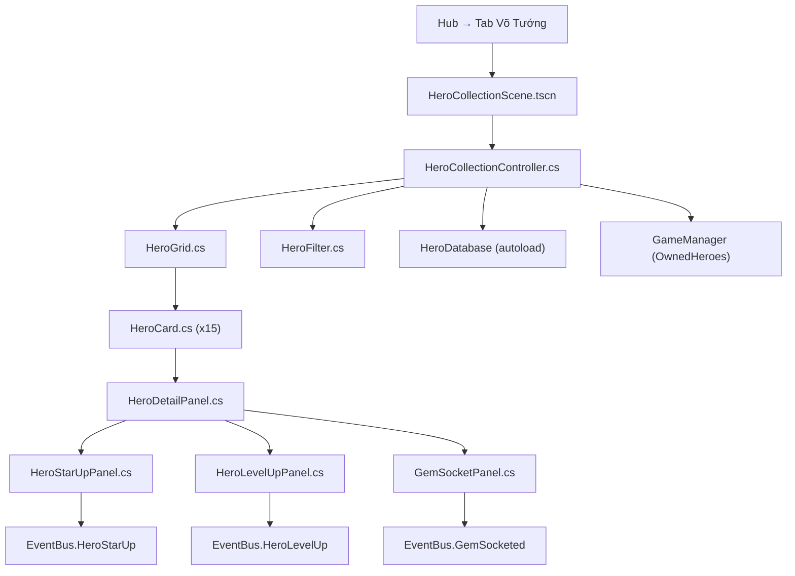

# Phase 5 — Hero Collection & Hero Detail (Tướng Phủ)

> **Ngày tạo:** 2026-10-17 | **Ưu tiên:** 🟢 Thấp | **Ước lượng:** 4-5 ngày | **Trạng thái:** ❌ Chưa bắt đầu

---

## 🎯 Mục Tiêu

- Màn hình xem toàn bộ 15 tướng đang sở hữu (Hero Collection)
- Panel chi tiết tướng: stats đầy đủ, kỹ năng, lore, sprite preview
- Hệ thống nâng sao (Star Up), tăng cấp (Level Up), và khảm ngọc (Gem Socket)

---

## 📋 Bảng Tổng Quan Công Việc

| # | Task | File | Ưu tiên | Ước lượng | Trạng thái |
|---|---|---|---|---|---|
| 5.1 | Scene Hero Collection | `HeroCollectionScene.tscn` | 🔴 | 1h | ❌ |
| 5.2 | Controller Hero Collection | `HeroCollectionController.cs` | 🔴 | 2h | ❌ |
| 5.3 | Grid card tướng | `HeroGrid.cs` | 🔴 | 1.5h | ❌ |
| 5.4 | Card tướng (dùng lại Phase 1) | `HeroCard.cs` | ✅ | — | Phase 1 |
| 5.5 | Panel chi tiết tướng | `HeroDetailPanel.cs` | 🔴 | 3h | ❌ |
| 5.6 | Panel nâng sao | `HeroStarUpPanel.cs` | 🟡 | 2h | ❌ |
| 5.7 | Panel tăng cấp | `HeroLevelUpPanel.cs` | 🟡 | 1.5h | ❌ |
| 5.8 | Panel khảm ngọc | `GemSocketPanel.cs` | 🟢 | 2h | ❌ |
| 5.9 | Bộ lọc & tìm kiếm | mở rộng `HeroFilter.cs` | 🟡 | 1h | Phase 1 |
| 5.10 | Data nâng cấp tướng | `HeroUpgradeData.cs` | 🔴 | 1h | ❌ |
| 5.11 | EventBus signals Hero | `EventBus.cs` | 🔴 | 0.5h | ❌ |
| 5.12 | Assets UI hero_info/ | `assets/ui/hero_info/` | 🔴 | 2h | ❌ |

---

## 📁 Sơ Đồ Quan Hệ File



---

## ✅ Chi Tiết Từng Task

### Task 5.1 — Tạo `HeroCollectionScene.tscn`

- [ ] Tạo file: `features/hero_collection/scenes/HeroCollectionScene.tscn`
- [ ] Root: `Control` full screen
- [ ] Layout: 2 panel — trái `HeroGrid` (60% width), phải `HeroDetailPanel` (40% width)
- [ ] `HeroFilter` — thanh lọc phía trên `HeroGrid`
- [ ] `LineEdit SearchBar` — tìm kiếm theo tên
- [ ] `Label TotalHeroLabel` — "Tướng: 15/15"
- [ ] `Button BackButton` — quay về Hub
- [ ] Attach script `HeroCollectionController.cs`

---

### Task 5.2 — Tạo `HeroCollectionController.cs`

**5.2.1 — Khởi tạo**
- [ ] `_Ready()`: Load tất cả `HeroData` từ `HeroDatabase` cho heroes trong `GameManager.OwnedHeroIds`
- [ ] Spawn `HeroCard` cho mỗi tướng vào `HeroGrid`
- [ ] Mặc định hiển thị chi tiết tướng đầu tiên trong `HeroDetailPanel`

**5.2.2 — Tương tác**
- [ ] `OnHeroCardClicked(string heroId)`: Cập nhật `HeroDetailPanel` với hero được chọn
- [ ] Highlight card đang được chọn
- [ ] `OnFilterChanged()`: Re-render `HeroGrid` theo filter
- [ ] `OnSearchChanged(string query)`: Lọc card theo tên

**5.2.3 — Nâng cấp**
- [ ] `OnStarUpCompleted(string heroId)`: Cập nhật card, cập nhật detail panel
- [ ] `OnLevelUpCompleted(string heroId)`: Cập nhật stats hiển thị
- [ ] Emit signals tương ứng

---

### Task 5.3 — Tạo `HeroGrid.cs`

- [ ] Tạo file: `features/hero_collection/ui/HeroGrid.cs` (extends `GridContainer`)
- [ ] `Columns = 5` (5 card mỗi hàng)
- [ ] `void PopulateGrid(List<HeroData> heroes)`: Spawn card
- [ ] `void FilterGrid(List<HeroData> filteredHeroes)`: Ẩn/hiện card theo filter
- [ ] `void SetSelectedHero(string heroId)`: Highlight card được chọn
- [ ] Scroll nếu số tướng nhiều hơn 1 hàng

---

### Task 5.5 — Tạo `HeroDetailPanel.cs`

- [ ] Tạo file: `features/hero_collection/ui/HeroDetailPanel.cs` (extends `PanelContainer`)
- [ ] Sub-nodes **Header**:
  - [ ] `AnimatedSprite2D HeroSprite` — sprite idle của tướng (24 frame)
  - [ ] `TextureRect Portrait` — portrait lớn (128x128)
  - [ ] `Label HeroNameLabel` — tên tướng (to, pixel font)
  - [ ] `HBoxContainer StarsRow` — sao hiện tại (1-5)
  - [ ] `Label LevelLabel` — "Lv. 45 / Max 60"
  - [ ] `TextureRect ElementIcon` — icon hệ nguyên tố
  - [ ] `Label RoleLabel` — vai trò: "Tiền phong / Hộ vệ..."
  - [ ] `Label PowerLabel` — lực chiến: "💪 12,450"
- [ ] Sub-nodes **Tab Bar** (3 tab):
  - [ ] Tab **Chỉ Số** → `StatsTab`
  - [ ] Tab **Kỹ Năng** → `SkillsTab`
  - [ ] Tab **Lore** → `LoreTab`
- [ ] **StatsTab**:
  - [ ] `GridContainer StatsGrid` (2 cột):
    - [ ] HP, ATK vật lý, ATK pháp, DEF vật lý, DEF pháp, Tốc độ
    - [ ] Bạo kích %, Né tránh %, Phản đòn %, Kháng khống chế %
    - [ ] Sĩ khí (Morale), Hồi nộ/lượt
  - [ ] Mỗi stat: icon nhỏ + tên + giá trị (màu xanh nếu được buff, đỏ nếu debuff)
- [ ] **SkillsTab**:
  - [ ] 4 kỹ năng (3 thường + 1 nộ chiêu):
    - [ ] Icon kỹ năng (64x64)
    - [ ] Tên kỹ năng
    - [ ] Mô tả đầy đủ (sát thương, hiệu ứng, cooldown, morale cost)
    - [ ] Level kỹ năng (1-5) + nút nâng cấp kỹ năng (tốn vàng)
- [ ] **LoreTab**:
  - [ ] `Label LoreText` — tiểu sử tướng (tiếng Việt)
  - [ ] `Label QuoteText` — câu nói nổi tiếng của tướng
- [ ] **Action Buttons** phía dưới:
  - [ ] `Button StarUpButton` — "Nâng Sao ⭐" → mở `HeroStarUpPanel`
  - [ ] `Button LevelUpButton` — "Tăng Cấp ↑" → mở `HeroLevelUpPanel`
  - [ ] `Button GemSocketButton` — "Khảm Ngọc 💎" → mở `GemSocketPanel`
  - [ ] `Button SetToFormationButton` — "Đưa Vào Đội Hình" → mở Formation Selector với tướng này pre-selected
- [ ] `void LoadHero(HeroData hero, HeroStats stats)`: Cập nhật toàn bộ UI

---

### Task 5.6 — Tạo `HeroStarUpPanel.cs`

- [ ] Tạo file: `features/hero_collection/ui/HeroStarUpPanel.cs` (extends `PanelContainer`)
- [ ] Popup overlay khi click Nâng Sao
- [ ] Hiển thị:
  - [ ] Sao hiện tại → Sao tiếp theo (animation)
  - [ ] Nguyên liệu cần: mảnh tướng (x30/x50/x80/x100/x150 tùy cấp sao), vàng
  - [ ] Số lượng đang có / cần thiếu (màu đỏ nếu không đủ)
- [ ] `Button ConfirmStarUp` — thực hiện nâng sao (disable nếu không đủ nguyên liệu)
- [ ] Animation nâng sao: burst ánh sáng, sao xuất hiện lần lượt
- [ ] Cập nhật stats preview: "ATK: 1,200 → 1,560 (+30%)"

---

### Task 5.7 — Tạo `HeroLevelUpPanel.cs`

- [ ] Tạo file: `features/hero_collection/ui/HeroLevelUpPanel.cs` (extends `PanelContainer`)
- [ ] Slider hoặc input số: chọn số cấp muốn tăng (1 → max có thể)
- [ ] Hiển thị:
  - [ ] Level hiện tại → Level sau
  - [ ] EXP Dan cần (đan dược) + vàng
  - [ ] Preview stats sau khi tăng (ATK +X, HP +Y, ...)
- [ ] 3 preset nhanh: "+1 cấp", "+5 cấp", "Tối đa"
- [ ] `Button ConfirmLevelUp`

---

### Task 5.8 — Tạo `GemSocketPanel.cs`

- [ ] Tạo file: `features/hero_collection/ui/GemSocketPanel.cs` (extends `PanelContainer`)
- [ ] 6 ô socket ngọc (Bảo thạch) trên hình tướng
- [ ] Mỗi socket: loại ngọc (Tấn công / Phòng thủ / Tốc độ / Bạo kích / Né tránh / HP)
- [ ] Click ô → popup chọn ngọc từ túi đồ
- [ ] Hiển thị bonus stats tổng từ ngọc đang khảm
- [ ] Button "Tháo Ngọc" (tốn 1 vàng nhỏ)

---

### Task 5.10 — Tạo `HeroUpgradeData.cs`

- [ ] Tạo file: `data/resources/HeroUpgradeData.cs` (extends `Resource`)
- [ ] Chi phí nâng sao theo từng cấp:
  ```csharp
  public Dictionary<int, StarUpCost> StarUpCosts { get; set; }
  // StarUpCost: int ShardCount, long GoldCost
  ```
- [ ] Chi phí tăng cấp:
  ```csharp
  public long GoldPerLevel { get; set; }        // vàng mỗi cấp
  public int ExpPotionPerLevel { get; set; }    // đan dược mỗi cấp
  public int MaxLevel { get; set; }            // level tối đa (phụ thuộc số sao)
  ```
- [ ] Mapping: sao → max level (1⭐=20, 2⭐=30, 3⭐=40, 4⭐=50, 5⭐=60)

---

### Task 5.11 — EventBus Signals Hero

```csharp
// Thêm vào EventBus.cs
[Signal] public delegate void HeroUnlockedEventHandler(string heroId);
[Signal] public delegate void HeroLevelUpEventHandler(string heroId, int newLevel);
[Signal] public delegate void HeroStarUpEventHandler(string heroId, int newStars);
[Signal] public delegate void HeroSkillUpgradedEventHandler(string heroId, int skillIndex, int newLevel);
[Signal] public delegate void GemSocketedEventHandler(string heroId, int socketIndex, string gemId);
[Signal] public delegate void GemRemovedEventHandler(string heroId, int socketIndex);
```

---

### Task 5.12 — Assets UI `assets/ui/hero_info/`

- [ ] `hero_detail_panel_bg.png` — nền panel chi tiết tướng (cổ phong)
- [ ] `stat_icon_hp.png` / `atk.png` / `def.png` / `spd.png` / `crit.png` / `dodge.png` (20x20)
- [ ] `skill_icon_frame_normal.png` (64x64) — khung icon kỹ năng thường
- [ ] `skill_icon_frame_rage.png` (64x64) — khung icon kỹ năng nộ (viền đỏ rực)
- [ ] `tab_active.png` / `tab_inactive.png` — tab chỉ số/kỹ năng/lore
- [ ] `star_small_filled.png` / `empty.png` (20x20) — sao nhỏ trong detail
- [ ] `socket_empty.png` (48x48) — ô khảm ngọc trống
- [ ] `socket_occupied.png` (48x48) — ô khảm ngọc đã có
- [ ] `gem_atk.png` / `gem_def.png` / `gem_spd.png` / `gem_crit.png` / `gem_dodge.png` / `gem_hp.png` (32x32)
- [ ] `btn_star_up.png` / `btn_level_up.png` / `btn_gem_socket.png` (140x40)

---

## ✅ Tiêu Chí Hoàn Thành

- [ ] Hero Collection mở từ Hub → Tab "Võ Tướng"
- [ ] 15 card tướng hiển thị trong grid, có thể scroll
- [ ] Click card → HeroDetailPanel cập nhật đúng tướng
- [ ] Tab Chỉ Số: tất cả stats hiển thị đúng
- [ ] Tab Kỹ Năng: 4 kỹ năng với mô tả đầy đủ
- [ ] Tab Lore: tiểu sử hiển thị
- [ ] Bộ lọc theo hệ và vai trò hoạt động
- [ ] Tìm kiếm theo tên hoạt động
- [ ] Nâng sao: trừ nguyên liệu đúng, cập nhật stats
- [ ] Tăng cấp: trừ đan dược + vàng, level tăng đúng
- [ ] Nút "Đưa Vào Đội Hình" chuyển sang Formation Selector với tướng pre-selected
