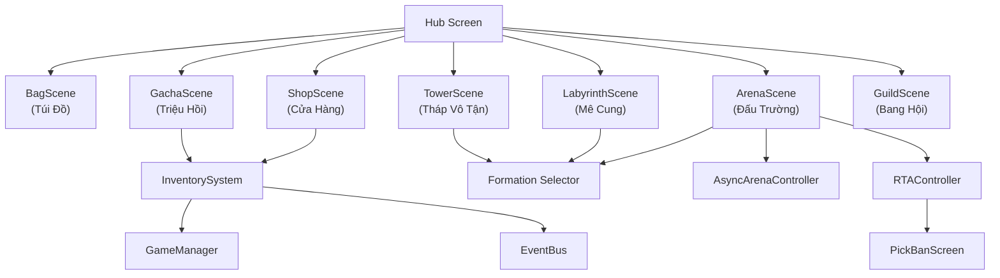

# Phase 6 — Economy, Gacha, Shop & PvP Systems

> **Ngày tạo:** 2026-10-17 | **Ưu tiên:** 🟢 Thấp | **Ước lượng:** 10-14 ngày | **Trạng thái:** ❌ Chưa bắt đầu

---

## 🎯 Mục Tiêu

- Hệ thống kinh tế trong game (tiền tệ, vật phẩm, túi đồ)
- Gacha/Triệu hồi với thuật toán pity bảo hiểm
- Cửa hàng (Shop) đa tab
- Đấu trường PvP (Async + RTA với Pick/Ban)
- Tháp Vô Tận 100+ tầng
- Mê Cung Rogue-like hàng tuần
- Bang Hội (Guild) cơ bản

---

## 📋 Bảng Tổng Quan Công Việc

| # | Task | File | Ưu tiên | Ước lượng | Trạng thái |
|---|---|---|---|---|---|
| 6.1 | Inventory (Túi đồ) | `InventorySystem.cs` + `BagScene.tscn` | 🔴 | 3h | ❌ |
| 6.2 | Item Data Resource | `ItemData.cs` | 🔴 | 1h | ❌ |
| 6.3 | Gacha System | `GachaController.cs` + `GachaScene.tscn` | 🔴 | 4h | ❌ |
| 6.4 | Pity Tracker | `PityTracker.cs` | 🔴 | 1h | ❌ |
| 6.5 | Gacha Animation | `GachaAnimation.cs` | 🟡 | 2h | ❌ |
| 6.6 | Shop System | `ShopController.cs` + `ShopScene.tscn` | 🔴 | 3h | ❌ |
| 6.7 | Shop Data Resource | `ShopItemData.cs` | 🟡 | 1h | ❌ |
| 6.8 | Daily Quest System | `DailyQuestSystem.cs` | 🟡 | 2h | ❌ |
| 6.9 | Async Arena | `AsyncArenaController.cs` | 🔴 | 3h | ❌ |
| 6.10 | RTA Arena | `RTAController.cs` | 🟡 | 4h | ❌ |
| 6.11 | Pick/Ban Screen | `PickBanScreen.cs` | 🟡 | 2.5h | ❌ |
| 6.12 | Ranking Panel | `RankingPanel.cs` | 🟡 | 1.5h | ❌ |
| 6.13 | Tower (Tháp Vô Tận) | `TowerController.cs` + `TowerScene.tscn` | 🟡 | 4h | ❌ |
| 6.14 | Labyrinth (Mê Cung) | `LabyrinthController.cs` + Scene | 🟢 | 5h | ❌ |
| 6.15 | Relic System | `RelicSystem.cs` | 🟢 | 2h | ❌ |
| 6.16 | Guild (Bang Hội) | `GuildController.cs` + Scene | 🟢 | 4h | ❌ |
| 6.17 | EventBus signals Phase 6 | `EventBus.cs` | 🔴 | 1h | ❌ |

---

## 📁 Sơ Đồ Quan Hệ Tổng Thể Phase 6



---

## ✅ Chi Tiết Từng Task

### Task 6.1 — Inventory System & BagScene

**6.1.1 — `InventorySystem.cs`** (Autoload singleton)
- [ ] Tạo file: `core/autoload/InventorySystem.cs`
- [ ] `Dictionary<string, int> Items` — itemId → số lượng
- [ ] `void AddItem(string itemId, int amount)`: Thêm vật phẩm
- [ ] `bool RemoveItem(string itemId, int amount)`: Trừ vật phẩm (false nếu không đủ)
- [ ] `int GetItemCount(string itemId)`: Lấy số lượng
- [ ] `List<(ItemData, int)> GetAllItems()`: Lấy toàn bộ túi
- [ ] `void Save()` / `void Load()`: Persist vào JSON
- [ ] Emit `EventBus.ItemAdded`, `EventBus.ItemRemoved`

**6.1.2 — `BagScene.tscn` + `BagController.cs`**
- [ ] Tab phân loại: Tiêu hao / Nâng cấp / Tướng mảnh / Ngọc / Trang bị
- [ ] `GridContainer ItemGrid` — hiện tất cả item theo tab
- [ ] Mỗi item cell: icon, số lượng, tên khi hover
- [ ] Click item: popup mô tả + nút Sử dụng (nếu usable)

---

### Task 6.2 — `ItemData.cs`

- [ ] Tạo file: `data/resources/ItemData.cs` (extends `Resource`)
- [ ] Fields:
  ```csharp
  public string ItemId { get; set; }
  public string ItemName { get; set; }
  public ItemType Type { get; set; }  // Consumable, Upgrade, Shard, Gem, Equipment
  public ItemRarity Rarity { get; set; } // Common, Rare, SR, SSR
  public string Description { get; set; }
  public Texture2D Icon { get; set; }
  public bool IsUsable { get; set; }
  public string UseEffect { get; set; }  // "add_exp:500", "add_gold:1000"
  ```
- [ ] Tạo các item `.tres` cơ bản trong `data/database/items/`:
  - [ ] `gold_coin.tres`, `diamond.tres`, `stamina_potion.tres`
  - [ ] `exp_potion_sm.tres`, `exp_potion_md.tres`, `exp_potion_lg.tres`
  - [ ] `hero_shard_generic.tres`
  - [ ] `gem_atk.tres`, `gem_def.tres`, `gem_spd.tres`, `gem_crit.tres`, `gem_dodge.tres`, `gem_hp.tres`
  - [ ] `summon_ticket.tres` — vé triệu hồi đơn
  - [ ] `summon_ticket_x10.tres` — vé triệu hồi x10

---

### Task 6.3 — `GachaController.cs` & `GachaScene.tscn`

**6.3.1 — `GachaScene.tscn`**
- [ ] Tab chọn banner: SSR Tướng / SR Pack / Normal Pack
- [ ] Mỗi banner:
  - [ ] Hình banner (artwork tướng featured)
  - [ ] Tỉ lệ rút (thông tin xác suất)
  - [ ] Pity counter: "Đã rút: 43/90 lần (pity SSR)"
  - [ ] Nút **x1** (tốn 1 vé) và **x10** (tốn 10 vé, giảm giá)
  - [ ] Chi phí: "160 Kim Cương" hoặc "1 Vé Triệu Hồi"

**6.3.2 — `GachaController.cs`**
- [ ] `GachaResult Roll(string bannerId, int times)`:
  - Tính xác suất: Common 60%, Rare 30%, SR 8%, SSR 2%
  - Áp dụng pity: SSR guaranteed sau 90 lần, SR guaranteed sau 10 lần
  - Trả về `List<GachaResult>`
- [ ] `GachaResult`: `string HeroId`, `ItemRarity Rarity`, `bool IsNew`
- [ ] Kiểm tra đủ vé/kim cương trước khi roll
- [ ] Thêm kết quả vào `InventorySystem` / mở khóa tướng mới
- [ ] Emit `EventBus.GachaRolled(List<GachaResult>)`

---

### Task 6.4 — `PityTracker.cs`

- [ ] Tạo file: `features/gacha/PityTracker.cs`
- [ ] Lưu per-banner:
  ```csharp
  public Dictionary<string, int> SsrPityCount { get; set; }  // đếm đến 90
  public Dictionary<string, int> SrPityCount { get; set; }   // đếm đến 10
  ```
- [ ] `void IncrementPity(string bannerId)`: Tăng counter sau mỗi lần roll
- [ ] `void ResetSsrPity(string bannerId)`: Reset khi ra SSR
- [ ] `bool IsSsrGuaranteed(string bannerId)`: Kiểm tra đã đến pity chưa
- [ ] Persist vào `PlayerProfile`

---

### Task 6.5 — `GachaAnimation.cs`

- [ ] Tạo file: `features/gacha/GachaAnimation.cs`
- [ ] Animation mở hòm (CardReveal):
  - Màn hình tối → hòm vàng xuất hiện → mở nắp
  - Thẻ tướng lật từng cái (x1: 1 thẻ, x10: 10 thẻ flip lần lượt)
  - SSR: hiệu ứng burst ánh sáng vàng, rung màn hình, âm thanh đặc biệt
  - SR: hiệu ứng ánh sáng tím
  - Common/Rare: flip nhanh
- [ ] Nút "Skip" bỏ qua animation
- [ ] Màn hình kết quả: grid card đã rút với badge NEW nếu lần đầu

---

### Task 6.6 — Shop System

**6.6.1 — `ShopScene.tscn`**
- [ ] Tab bar: Hàng Ngày / Kim Cương / Bang Hội / Nạp Tiền
- [ ] **Hàng Ngày**: 6-9 slot ngẫu nhiên, reset 00:00, mua = vàng
  - [ ] Countdown timer đến reset
  - [ ] Slot đã mua: dim + "Đã mua"
- [ ] **Kim Cương**: vé triệu hồi, đan dược, ngọc đặc biệt, mua = kim cương
- [ ] **Bang Hội**: item đặc biệt, mua = điểm bang hội
- [ ] **Nạp Tiền** (IAP stub): gói kim cương, Battle Pass (hiển thị, chưa implement)

**6.6.2 — `ShopController.cs`**
- [ ] `bool PurchaseItem(string shopItemId)`:
  - Kiểm tra đủ tiền
  - Trừ tiền, thêm item vào `InventorySystem`
  - Emit `EventBus.ItemPurchased`
- [ ] `void LoadDailyShop()`: Tạo danh sách random từ pool ngày hôm đó (seed theo ngày)
- [ ] `void ResetDailyShop()`: Kết nối với DailyQuestSystem timer reset 00:00

---

### Task 6.7 — `ShopItemData.cs`

- [ ] Tạo file: `data/resources/ShopItemData.cs` (extends `Resource`)
- [ ] Fields: `string ItemId`, `int Amount`, `CurrencyType Currency`, `int Price`, `int StockLimit` (0 = không giới hạn), `ShopTab Tab`

---

### Task 6.8 — Daily Quest System

- [ ] Tạo file: `core/systems/DailyQuestSystem.cs` (Autoload)
- [ ] 5 nhiệm vụ hàng ngày cố định:
  - "Tham gia 1 trận chiến" → +100 EXP, +50 Vàng
  - "Vượt 3 ải Campaign" → +200 EXP, +1 Vé Triệu Hồi
  - "Tặng quà bang hội 1 lần" → +50 EXP
  - "Dùng 5 Lệnh (Stamina)" → +100 Vàng
  - "Đăng nhập hàng ngày" → +30 Kim Cương
- [ ] `void TrackAction(string actionType, int amount)`: Cập nhật tiến độ
- [ ] `void ClaimReward(string questId)`: Trao phần thưởng
- [ ] `void DailyReset()`: Reset lúc 00:00 server time
- [ ] Kết nối vào Hub `QuestPanel`

---

### Task 6.9 — Async Arena

- [ ] Tạo file: `features/arena/controllers/AsyncArenaController.cs`
- [ ] **Màn hình Arena**:
  - [ ] Danh sách 10 đối thủ gần rank (tên, rank, lực chiến, đội hình phòng thủ thu nhỏ)
  - [ ] Rank của người chơi + điểm Danh Vọng hiện tại
  - [ ] Nút "Làm mới danh sách" (tốn kim cương)
- [ ] **Tấn công**:
  - [ ] Chọn đối thủ → xem đội hình phòng thủ của họ
  - [ ] Nút "Chiến" → Formation Selector → Battle vs AI (đội phòng thủ đối thủ)
  - [ ] Thắng: +Danh Vọng, có thể leo rank
  - [ ] Thua: -Danh Vọng nhỏ
- [ ] **Phòng thủ**:
  - [ ] Người chơi set Defense Team (qua Formation Selector, context="arena_defense")
  - [ ] AI tự chiến khi bị tấn công
- [ ] **Xếp hạng**: 7 bậc (Đồng → Huyền Thoại), phần thưởng tuần theo bậc
- [ ] Giới hạn 5 lần tấn công/ngày (reset 00:00)

---

### Task 6.10 — RTA Arena (Real-Time)

- [ ] Tạo file: `features/arena/controllers/RTAController.cs`
- [ ] **Matchmaking** (stub/offline trước, online sau):
  - [ ] Nút "Tìm Trận" → simulate tìm đối thủ cùng rank
  - [ ] Countdown 30s, nếu không tìm được → match vs bot
- [ ] **Giai đoạn Pick/Ban** (15s/turn):
  - [ ] Mỗi bên cấm 1 tướng (không ai dùng được)
  - [ ] Lần lượt chọn tướng: Ta chọn 1 → Địch chọn 1 → ... cho đến 5 tướng
  - [ ] Timer 15s/turn, hết thời gian → auto-pick ngẫu nhiên
- [ ] **Trận đấu**: Battle Engine như thường, nhưng manual mode bắt buộc
- [ ] **Kết quả**: +/- điểm RTA riêng biệt với Async Arena

---

### Task 6.11 — `PickBanScreen.cs`

- [ ] Tạo file: `features/arena/scenes/PickBanScreen.cs` (extends `Control`)
- [ ] Layout:
  - [ ] Phần trên: 5 slot tướng phe Ta + 5 slot tướng phe Địch
  - [ ] Phần giữa: grid 15 tướng để chọn/cấm (dim tướng đã bị cấm/chọn)
  - [ ] Phần dưới: timer 15s (countdown bar)
  - [ ] Label "Lượt của bạn: CẤM tướng" / "CHỌN tướng"
- [ ] Animation khi cấm: dấu X đỏ xuất hiện trên tướng
- [ ] Animation khi chọn: tướng bay vào slot của đội
- [ ] Timer âm thanh: tick-tock khi còn < 5s

---

### Task 6.12 — `RankingPanel.cs`

- [ ] Tạo file: `features/arena/ui/RankingPanel.cs`
- [ ] Top 100 người chơi server (mock data trước)
- [ ] Highlight hàng của người chơi hiện tại
- [ ] Hiển thị: rank, avatar, tên, guild, điểm Danh Vọng, bậc rank
- [ ] Phần thưởng tuần hiển thị theo bậc

---

### Task 6.13 — Tower (Tháp Vô Tận)

**`TowerScene.tscn` + `TowerController.cs`**
- [ ] Giao diện: list tầng (1-100), mỗi tầng có icon, boss icon ở tầng x10
- [ ] Hiển thị tầng cao nhất đã đạt: "Tầng cao nhất: 23"
- [ ] Click tầng → popup: enemy level, phần thưởng
- [ ] Chỉ cho đánh từ tầng hiện tại (không skip)
- [ ] Cơ chế Boss tầng 10, 20, ..., 100:
  - [ ] Boss có cơ chế đặc biệt: miễn dịch khống chế (tầng 10), phản sát thương 20% (tầng 30), AoE mỗi lượt (tầng 50)
  - [ ] Data boss lưu trong `data/database/tower/`
- [ ] Reset phần thưởng hàng tháng (không reset tiến độ)
- [ ] **`TowerStageData.cs`**: FloorNumber, EnemyFormation, BossSpecialMechanic, Rewards

---

### Task 6.14 — Labyrinth (Mê Cung Rogue-like)

**`LabyrinthScene.tscn` + `LabyrinthController.cs`**
- [ ] Bản đồ dạng lưới 5x5, random seed theo tuần
- [ ] Mỗi ô: combat / rest (hồi HP) / treasure / event / boss
- [ ] Người chơi di chuyển từng ô, chỉ đến ô kề cạnh
- [ ] HP và Morale **bảo lưu** qua từng trận (không hồi giữa các ô)
- [ ] Rest node: hồi 20% HP cho đội
- [ ] Treasure node: random item
- [ ] Event node: event text "Thương nhân xuất hiện..." + lựa chọn
- [ ] Boss cuối (ô góc đối diện): boss mạnh, phần thưởng lớn
- [ ] Reset bản đồ mỗi tuần (thứ 2 00:00)

---

### Task 6.15 — `RelicSystem.cs`

- [ ] Tạo file: `features/labyrinth/RelicSystem.cs`
- [ ] Relic (Thánh Vật): buff tạm thời trong suốt hành trình mê cung
- [ ] Ví dụ relic:
  - "Ngọc Tâm Hỏa": ATK tăng 15% trong mê cung
  - "Bản Đồ Cổ": Tiết lộ nội dung 2 ô ẩn
  - "Bình Dưỡng Thần": Hồi 10% HP sau mỗi trận thắng
  - "Kiếm Thần": Bạo kích +20%
- [ ] Tối đa 3 relic cùng lúc
- [ ] Drop ngẫu nhiên từ treasure nodes
- [ ] `RelicData.cs`: Id, Name, Description, Effect, Rarity

---

### Task 6.16 — Guild (Bang Hội Cơ Bản)

**`GuildScene.tscn` + `GuildController.cs`**
- [ ] Thông tin bang: tên, level, số thành viên, thông báo bang
- [ ] Danh sách thành viên: tên, rank trong bang, lực chiến, đóng góp
- [ ] **Donate hàng ngày**: donate vàng → nhận điểm bang hội + EXP bang
- [ ] **Boss Bang Hội** (Guild Raid) — stub:
  - [ ] Boss nhiều giai đoạn HP (10M HP)
  - [ ] Mỗi thành viên tấn công 1-3 lần/ngày
  - [ ] Xếp hạng sát thương, trao thưởng tuần
- [ ] **Bang Chiến** (Guild War) — stub cho Phase sau
- [ ] Tạo bang / Gia nhập bang (search by name)

---

### Task 6.17 — EventBus Signals Phase 6

```csharp
// Inventory
[Signal] public delegate void ItemAddedEventHandler(string itemId, int amount);
[Signal] public delegate void ItemRemovedEventHandler(string itemId, int amount);
[Signal] public delegate void ItemPurchasedEventHandler(string shopItemId);

// Gacha
[Signal] public delegate void GachaRolledEventHandler(Godot.Collections.Array results);
[Signal] public delegate void HeroPulledEventHandler(string heroId, string rarity);
[Signal] public delegate void PityCounterUpdatedEventHandler(string bannerId, int ssrCount, int srCount);

// Arena
[Signal] public delegate void ArenaMatchFoundEventHandler(string opponentId);
[Signal] public delegate void ArenaMatchResultEventHandler(bool won, int pointDelta);
[Signal] public delegate void ArenaRankChangedEventHandler(int newRank, string tier);
[Signal] public delegate void PickBanPhaseStartedEventHandler();
[Signal] public delegate void HeroBannedEventHandler(string heroId, bool byPlayer);
[Signal] public delegate void HeroPickedEventHandler(string heroId, bool byPlayer);

// Tower
[Signal] public delegate void TowerFloorClearedEventHandler(int floor);
[Signal] public delegate void TowerNewRecordEventHandler(int floor);

// Labyrinth
[Signal] public delegate void LabyrinthNodeEnteredEventHandler(string nodeType);
[Signal] public delegate void RelicObtainedEventHandler(string relicId);
[Signal] public delegate void LabyrinthCompletedEventHandler(int totalRooms);

// Guild
[Signal] public delegate void GuildDonatedEventHandler(int amount, int pointsEarned);
[Signal] public delegate void GuildBossAttackedEventHandler(int damage);
```

---

## ✅ Tiêu Chí Hoàn Thành Phase 6

- [ ] Túi đồ hiển thị và phân loại đúng item
- [ ] Gacha roll 10 lần không crash, xác suất đúng, pity tích lũy đúng
- [ ] Gacha animation mượt, SSR có hiệu ứng đặc biệt
- [ ] Shop hàng ngày refresh đúng 00:00
- [ ] Async Arena: tấn công được 10 đối thủ mock, kết quả tính đúng Danh Vọng
- [ ] Pick/Ban: timer 15s, auto-pick khi hết thời gian
- [ ] Tower: leo được tầng 1-20, boss tầng 10 có cơ chế đặc biệt
- [ ] Labyrinth: bản đồ random 5x5, HP bảo lưu qua trận, relic nhặt được
- [ ] Guild: donate hàng ngày, xem thành viên
- [ ] Tất cả transitions không crash, không memory leak
